# Boletín 2: GitHub y colaboración con Pull Requests

## Resumen de commits

Los commits 1 a 7, el 9 y el 10 aparecen en el historial de `main` de GitHub.
El commit del intento de push directo (8) se conserva únicamente en la rama
local `main`; no forma parte del historial remoto publicado.

| # | Mensaje del commit | Qué se hizo | Autor | Enlace de GitHub |
|---|--------------------|-------------|-------|------------------|
| 1 | `docs(readme): Instrucciones poner en marcha el proyecto` | Se documentaron la API, sus requisitos, cómo arrancarla y sus endpoints. | Sergio Antón | [3f10029](https://github.com/SergioAntonLopezumu/PC_26-27/commit/3f100294820346f2c494d8d8fdc05718a5cad37c) |
| 2 | `docs(pull_request_template): Añadida plantilla para PR` | Se añadió la plantilla que guía la descripción, las pruebas y las notas de revisión de los PR. | Sergio Antón | [124dc62](https://github.com/SergioAntonLopezumu/PC_26-27/commit/124dc62208d176a0e5932cf1a38d92922972146d) |
| 3 | `docs(enhancement): Añadida plantilla para issues de enhancement` | Se añadió la plantilla de Issues para proponer mejoras. | Sergio Antón | [72a3856](https://github.com/SergioAntonLopezumu/PC_26-27/commit/72a38562edf16de1e6c1af3adaf0d8b06b5d2180) |
| 4 | `chore(github): añade plantilla de issue para bugs` | Se añadió la plantilla de Issues para informar de errores. | Juan Aledo Sánchez | [5eee22e](https://github.com/SergioAntonLopezumu/PC_26-27/commit/5eee22ed24f4e5a7d025c9d1b476fec64b8c4629) |
| 5 | `chore(github): añade CODEOWNERS` | Se definieron los propietarios de código que deben revisar cambios en la aplicación. | Juan Aledo Sánchez | [934b286](https://github.com/SergioAntonLopezumu/PC_26-27/commit/934b2860e5f07c0966920a6dfcb2cc788a48a311) |
| 6 | `docs: añade guía de contribución` | Se añadieron instrucciones básicas para contribuir al proyecto. | Juan Aledo Sánchez | [f73b480](https://github.com/SergioAntonLopezumu/PC_26-27/commit/f73b4803872ff3db2c0b6f9e65387a357ec15252) |
| 7 | `feat(tasks): añade búsqueda de tareas por estado (#3)` | Se incorporó y fusionó el primer PR con el filtro opcional de tareas por estado. | Sergio Antón | [077b02b](https://github.com/SergioAntonLopezumu/PC_26-27/commit/077b02b125c9dabb0165450d345538607e8fc93c) |
| 8 | `chore: intento de push directo` | Commit local de prueba de la Parte C; el servidor rechazó el push. | Sergio Antón (ShadowBoyexe) | Sin enlace (solo local) |
| 9 | `feat(tasks): anade paginacion en el listado (#4)` | Se fusionó el segundo PR: paginación con `page` y `size` en `GET /api/tasks`. | Juan Aledo Sánchez | [4394f6a](https://github.com/SergioAntonLopezumu/PC_26-27/commit/4394f6abc36727885e01668dfdb517a03342e69a) |
| 10 | `docs(readme): cambia titulo (rama A) (#5)` | Primera rama de la Parte E, fusionada por PR para provocar el conflicto. | Juan Aledo Sánchez | [ecb1f43](https://github.com/SergioAntonLopezumu/PC_26-27/commit/ecb1f437f40d9e661695478e2d5c27b8e1a20176) |

## Detalle por commit

### 1. `docs(readme): Instrucciones poner en marcha el proyecto`

- **Qué se hizo:** Se documentó cómo preparar y ejecutar el proyecto, cómo probar la API y cuáles son sus endpoints.
- **Autor:** Sergio Antón
- **Relación con el boletín:** Parte A. Se amplió el README para facilitar la puesta en marcha del proyecto.
- **Uso de IA:** No consta.

### 2. `docs(pull_request_template): Añadida plantilla para PR`

- **Qué se hizo:** Se creó `.github/PULL_REQUEST_TEMPLATE.md` con secciones para describir el cambio, indicar las pruebas y dejar notas para quien revise.
- **Autor:** Sergio Antón
- **Relación con el boletín:** Parte B. La plantilla también solicita enlazar el Issue mediante `Closes #`.
- **Uso de IA:** No consta.

### 3. `docs(enhancement): Añadida plantilla para issues de enhancement`

- **Qué se hizo:** Se creó la plantilla de Issue para describir mejoras, su objetivo y sus criterios de aceptación.
- **Autor:** Sergio Antón
- **Relación con el boletín:** Parte B. La plantilla tiene la etiqueta `enhancement`.
- **Uso de IA:** No consta.

### 4. `chore(github): añade plantilla de issue para bugs`

- **Qué se hizo:** Se añadió una plantilla de Issue para describir un fallo, sus pasos de reproducción y los resultados esperado y actual.
- **Autor:** Juan Aledo Sánchez
- **Relación con el boletín:** Parte B. La plantilla tiene la etiqueta `bug`.
- **Uso de IA:** No consta.

### 5. `chore(github): añade CODEOWNERS`

- **Qué se hizo:** Se añadió `.github/CODEOWNERS` con `@swagdogeman` y `@SergioAntonLopezumu` como propietarios de toda la aplicación.
- **Autor:** Juan Aledo Sánchez
- **Relación con el boletín:** Parte B. GitHub puede solicitar la revisión de los propietarios cuando un PR modifica archivos cubiertos por esta regla.
- **Uso de IA:** No consta.

### 6. `docs: añade guía de contribución`

- **Qué se hizo:** Se añadió `CONTRIBUTING.md` con un flujo breve para contribuir, crear ramas y ejecutar las pruebas.
- **Autor:** Juan Aledo Sánchez
- **Relación con el boletín:** Parte B. La guía incluye las convenciones de nombres de ramas y recomienda ejecutar `mvn test`.
- **Uso de IA:** No consta.

### 7. `feat(tasks): añade búsqueda de tareas por estado (#3)`

- **Qué se hizo:** Se añadió el parámetro opcional `status` a `GET /api/tasks`. Acepta `PENDING`, `IN_PROGRESS` y `COMPLETED`; sin el parámetro devuelve todas las tareas y un valor no válido produce HTTP 400. Se añadieron pruebas automatizadas y se actualizó el README.
- **Autor:** Sergio Antón
- **Relación con el boletín:** Parte D. Es el primer ciclo de PR completado: el [Issue #1](https://github.com/SergioAntonLopezumu/PC_26-27/issues/1) estaba etiquetado como `enhancement`, se abrió el [PR #3](https://github.com/SergioAntonLopezumu/PC_26-27/pull/3), `SwagDogeMan` lo revisó y aprobó, y después se fusionó mediante *squash and merge*. El PR cerró el Issue.
- **Uso de IA:** Se utilizó la IA integrada en Visual Studio Code para implementar el filtro y sus pruebas. Se verificó con `mvn spotless:check test`; pasaron los 10 tests.

### 8. `chore: intento de push directo`

- **Qué se hizo:** Se creó el commit local de prueba descrito en la Parte C.
- **Autor:** ShadowBoyexe (Sergio Antón)
- **Relación con el boletín:** Parte C. El commit aparece en la rama local `main`, pero no en el historial remoto de `main`. Por tanto, no debe confundirse con un cambio fusionado o publicado. La configuración y el resultado detallado de las reglas de protección deben acreditarse con la configuración de GitHub o una captura.
- **Uso de IA:** No consta.

### 9. `feat(tasks): anade paginacion en el listado (#4)`

- **Qué se hizo:** Se añadieron los parámetros opcionales `page` y `size` a `GET /api/tasks` (por defecto `page=0` y `size=10`). La respuesta incluye `content`, `totalElements`, `totalPages`, `page` y `size`. Una página fuera de rango devuelve lista vacía y los valores inválidos (`page < 0` o `size <= 0`) devuelven HTTP 400. Se mantiene el filtro por `status` y se actualizaron tests y documentación.
- **Autor:** Juan Aledo Sánchez
- **Relación con el boletín:** Parte D, segundo ciclo con los roles cambiados. Se abrió el [PR #4](https://github.com/SergioAntonLopezumu/PC_26-27/pull/4) con `Close #2` y se fusionó mediante *squash and merge*.
- **Uso de IA:** Sí. Se utilizó IA (Sonnet 5.5 y GitHub Copilot) para implementar la paginación y sus tests. Se verificó el resultado antes de abrir el PR.

### 10. `docs(readme): cambia titulo (rama A) (#5)`

- **Qué se hizo:** Se cambió el título del README en la rama `docs/conflicto-a` y se fusionó con el [PR #5](https://github.com/SergioAntonLopezumu/PC_26-27/pull/5).
- **Autor:** Juan Aledo Sánchez
- **Relación con el boletín:** Parte E, primer paso. Esta rama modifica la línea que después se cambia en la segunda rama para provocar el conflicto.
- **Uso de IA:** No consta.

## Descripción narrativa de lo hecho y relación con el boletín

### Parte A — Publicar el repositorio

El proyecto se trabaja en el repositorio GitHub
[SergioAntonLopezumu/PC_26-27](https://github.com/SergioAntonLopezumu/PC_26-27), conectado al repositorio local mediante `origin`. Se amplió el README con información para poner en marcha y probar la API.

### Parte B — Gobernanza del repositorio

Se prepararon las plantillas de Pull Request e Issues para mejoras y errores, se añadió `.github/CODEOWNERS` y se creó `CONTRIBUTING.md`. La plantilla de PR permite enlazar el Issue y registrar cómo se probó el cambio. En el PR #3 se recibió una revisión de una persona colaboradora y una aprobación.

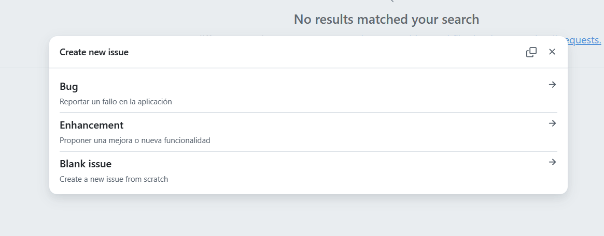

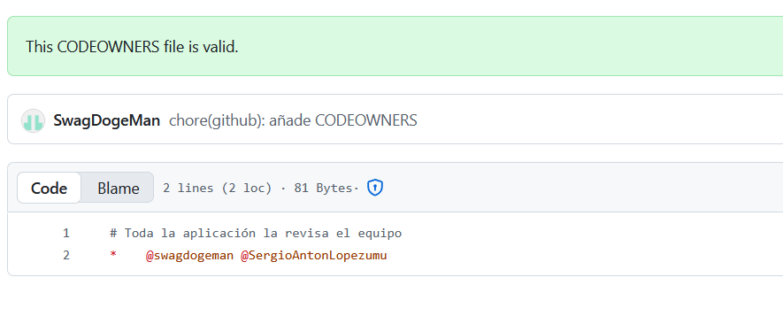

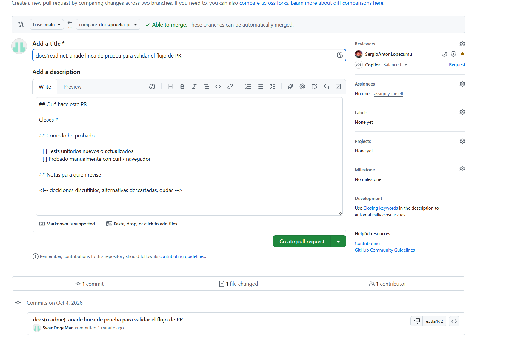

### Parte C — Proteger la rama `main`

Se creó el commit local `chore: intento de push directo` como parte de la prueba de push directo. Ese commit no aparece en el historial remoto de `main`. El historial por sí solo no permite verificar todas las opciones de protección solicitadas —por ejemplo, la aprobación obligatoria, la resolución de conversaciones o la prohibición de force push—; conviene adjuntar una captura de las reglas de GitHub y del resultado del intento de push.

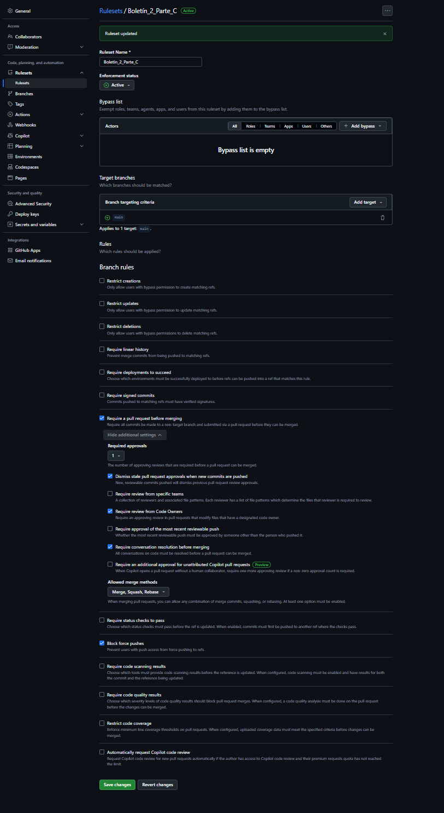

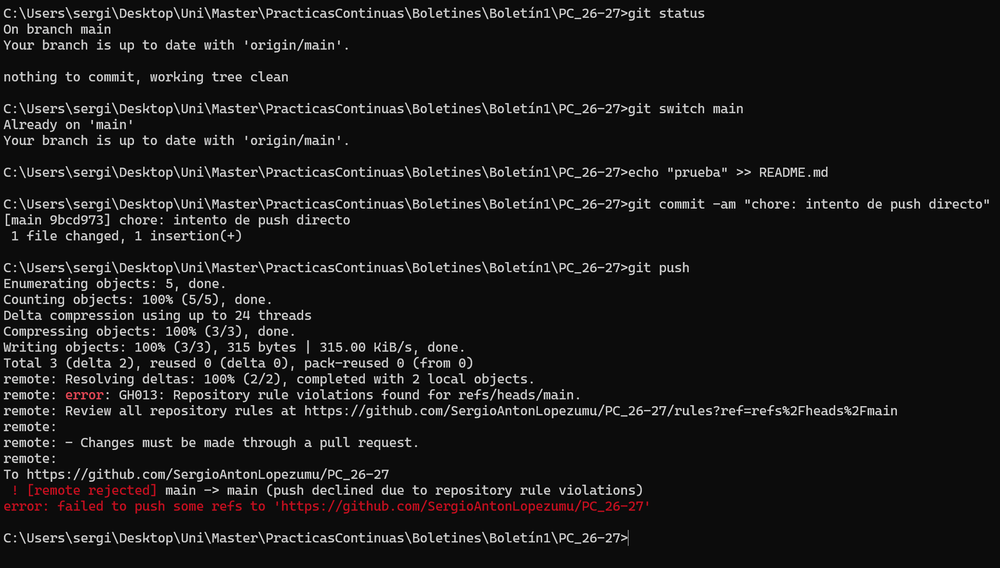

### Parte D — Trabajo por Pull Requests

Se completó un primer ciclo:

1. Se creó el [Issue #1](https://github.com/SergioAntonLopezumu/PC_26-27/issues/1) con la etiqueta `enhancement`.
2. Se implementó la búsqueda de tareas por estado en una rama de funcionalidad.
3. Se añadieron pruebas para el filtro, el listado sin filtro y los estados no válidos.
4. Se abrió el [PR #3](https://github.com/SergioAntonLopezumu/PC_26-27/pull/3), enlazando el Issue.
5. `SwagDogeMan` revisó y aprobó el PR.
6. El PR se fusionó mediante *squash and merge*.

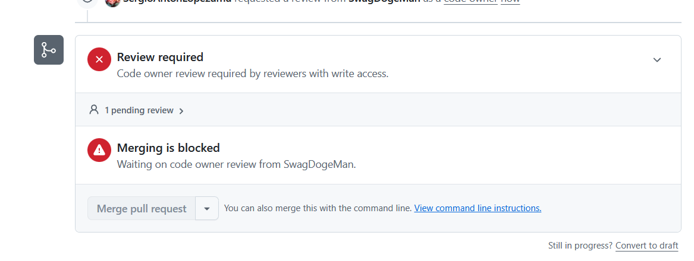

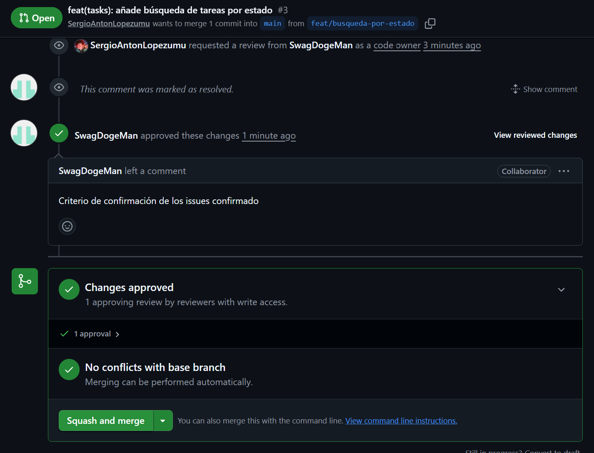

Segundo ciclo, con los roles cambiados:

1. `SwagDogeMan` creó el [Issue #2](https://github.com/SergioAntonLopezumu/PC_26-27/issues/2) «[ENH] Paginación en el listado», con la etiqueta `enhancement`.
2. Se implementó la paginación en la rama `feat/paginacion-listado`: parámetros opcionales `page` y `size` en `GET /api/tasks`, con valores por defecto y error 400 para valores inválidos.
3. Se actualizaron los tests unitarios y de controlador, y la documentación del endpoint.
4. `SwagDogeMan` abrió el [PR #4](https://github.com/SergioAntonLopezumu/PC_26-27/pull/4) con la plantilla y `Close #2`.
5. `SergioAntonLopezumu` revisó y aprobó el PR («Criterios de los issues confirmados»).
6. El PR se fusionó mediante *squash and merge* y el Issue #2 se cerró automáticamente como completado.

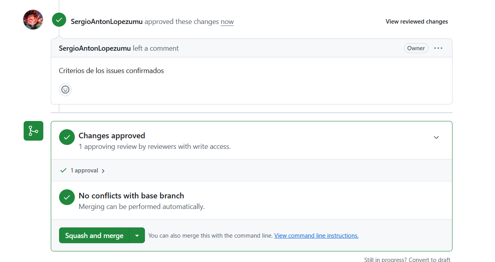

Con el PR #3 (abierto por Sergio Antón y revisado por `SwagDogeMan`) y el PR #4 (abierto por `SwagDogeMan`) quedan cubiertos los dos ciclos.

### Parte E — Provocar un conflicto en un PR

1. Se crearon las ramas `docs/conflicto-a` y `docs/conflicto-b` desde el mismo `main`, ambas modificando la misma línea del README (el título).
2. Se fusionó la primera mediante el [PR #5](https://github.com/SergioAntonLopezumu/PC_26-27/pull/5) (commit `ecb1f43`).
3. Se abrió el [PR #6](https://github.com/SergioAntonLopezumu/PC_26-27/pull/6) con la segunda rama y GitHub mostró el aviso «This branch has conflicts that must be resolved» sobre `README.md`. [ADJUNTAR CAPTURA]
4. Al hacer `git rebase origin/main`, Git descartó el primer commit de la rama B (`patch contents already upstream`) porque tenía el mismo texto que la A, y el rebase terminó sin conflicto. El PR #6 quedó cerrado sin fusionar. Para repetirlo con un conflicto real hay que usar textos distintos en la misma línea.

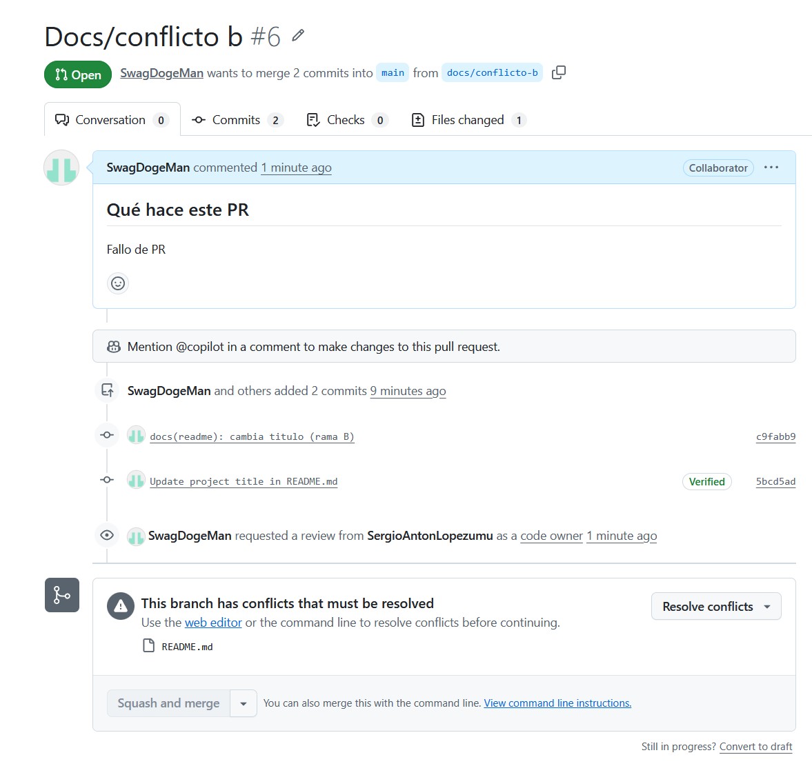

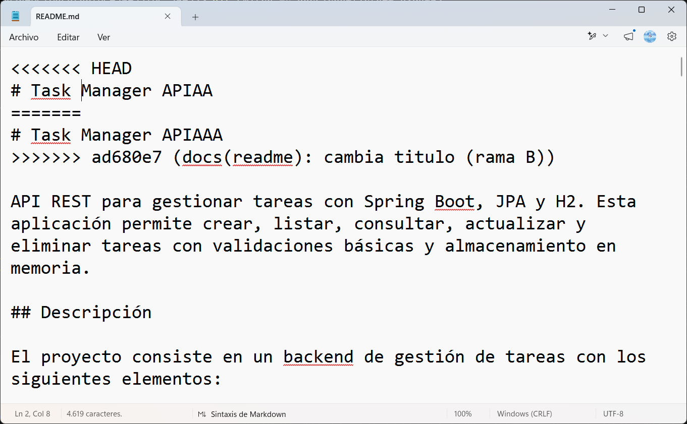

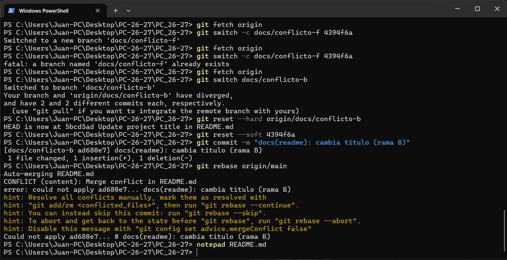

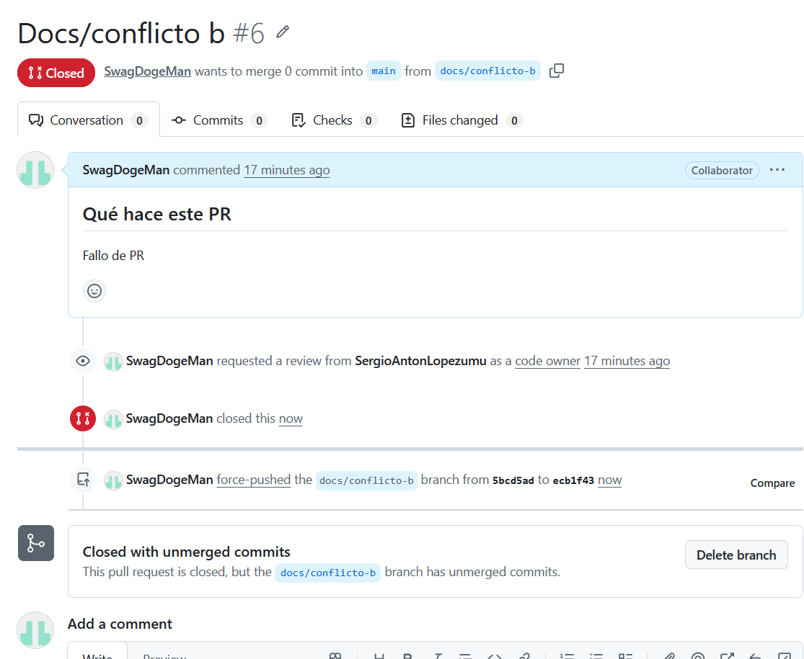

### Parte F — PR con fork

Enlace al Pull request del repositorio del grupo 11

https://github.com/josejavierml03/api-tareas/pull/11

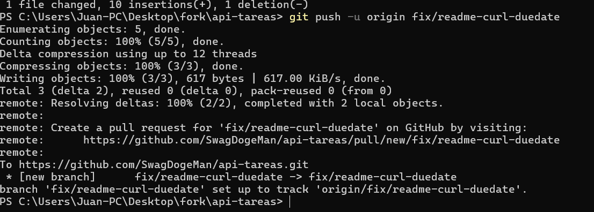

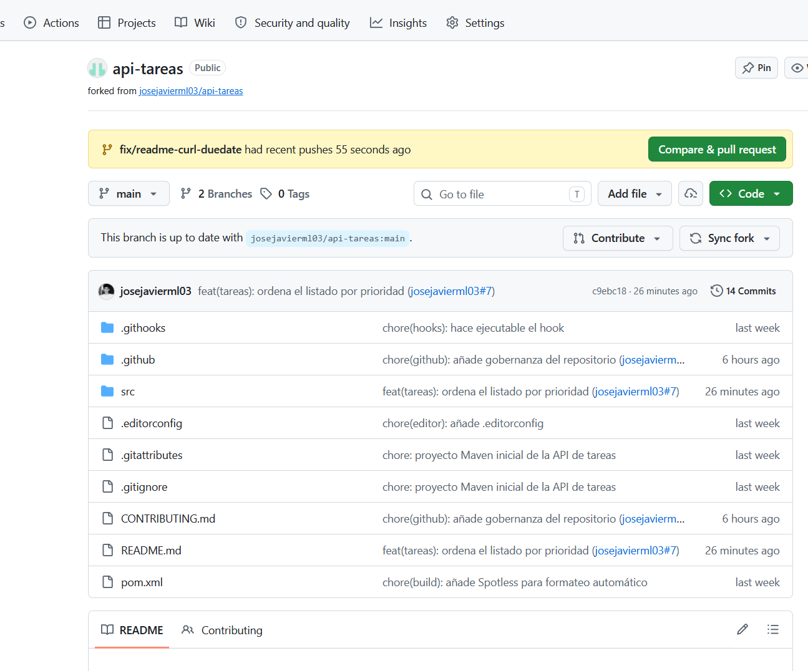

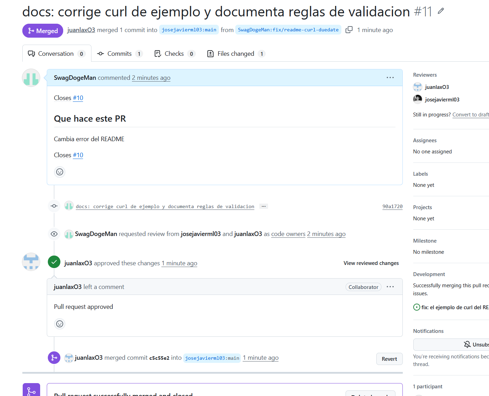
