# Boletín 3: Docker: contenerizar la aplicación

## Resumen de commits

El trabajo se hace en la rama `boletin3` del repositorio [PC_26-27](https://github.com/SergioAntonLopezumu/PC_26-27), creada a partir de `main` (commit base `f7a1eca`), y se integra en `main` mediante un Pull Request. Las partes H e I no modifican el repositorio y solo se documentan en esta memoria.

| # | Mensaje del commit | Qué se hizo | Autor | Enlace de GitHub |
|---|--------------------|-------------|-------|------------------|
| 1 | `feat: añadir Actuator y endpoint de salud` | Se añadió `spring-boot-starter-actuator` al `pom.xml` y se expusieron solo `health` e `info` en `application.properties`. | Juan Aledo Sánchez | [c0a9c90](https://github.com/SergioAntonLopezumu/PC_26-27/commit/c0a9c9084a635639e3a8e44b211ba832f23e31e3) |
| 2 | `feat: Dockerfile multi-stage y .dockerignore` | Se creó el Dockerfile en dos etapas (build con Maven y runtime con JRE, usuario no root y healthcheck) y el `.dockerignore`. | Juan Aledo Sánchez | [e3f18d9](https://github.com/SergioAntonLopezumu/PC_26-27/commit/e3f18d9866dfa60d5f45837ee081e8fae3867a1b) |
| 3 | `feat(docker): migrar a postgresql y añadir docker-compose` | Se sustituyó la base de datos H2 por PostgreSQL y se configuró el entorno con Docker Compose para garantizar la persistencia de los datos. | Irene Moreno Cegarra | [fcf2805](https://github.com/SergioAntonLopezumu/PC_26-27/commit/fcf2805bc181170ba2728b53b579af6c1e8363f2) |
| 4 | `feat(docker): externalizar configuración a fichero .env` | Se eliminaron las credenciales en texto plano del docker-compose.yml y se implementó el uso de variables de entorno mediante un fichero .env y una plantilla .env.example. | Irene Moreno Cegarra | [4fe1173](https://github.com/SergioAntonLopezumu/PC_26-27/commit/4fe1173584d5389425650bd48791428f6e905959) |
| 5 | `feat(devcontainer): configurar entorno de desarrollo como código` | Se creó la configuración de Dev Containers para estandarizar el entorno de desarrollo (JDK, Maven, extensiones de VS Code) mediante el archivo devcontainer.json. | Irene Moreno Cegarra | [a6d7fcd](https://github.com/SergioAntonLopezumu/PC_26-27/commit/a6d7fcd2cdf20d9e61f57a6190c60485444a8041) |
| 6 | `docs(readme): documenta ejecución con Docker y Dev Container` | Se actualizó el `README.md`: se sustituyeron las referencias a H2 por PostgreSQL, se eliminó la sección de H2 Console y se añadieron las secciones "Ejecutar con Docker" y "Ejecutar con Dev Container". | Sergio Antón López | [851fed9](https://github.com/SergioAntonLopezumu/PC_26-27/commit/851fed9db223be0ebd598a92ecba9d4eb3ad9697) |
| 7 | `Merge branch 'main' into docs/readme-docker` | Se fusionó `main` en la rama del PR para resolver el conflicto en `.github/CODEOWNERS` y poder integrar los cambios. | Juan Aledo Sánchez | [1e8a358](https://github.com/SergioAntonLopezumu/PC_26-27/commit/1e8a35852a5700fb452ad811ca725fa4a66ff57c) |
| 8 | `Merge pull request #15 from SergioAntonLopezumu/docs/readme-docker` | Se fusionó el PR #15 en `main`, con lo que los commits 1 a 6 del boletín quedan en `main`. | Juan Aledo Sánchez | [d7fb673](https://github.com/SergioAntonLopezumu/PC_26-27/commit/d7fb67320978dce9187de2e5b4d27964dec546aa) |


## Detalle por commit

### 1. `feat: añadir Actuator y endpoint de salud`

- **Qué se hizo:** Se añadió `spring-boot-starter-actuator` al `pom.xml` y se expusieron solo `health` e `info` en `application.properties`.
- **Autor:** Juan Aledo Sánchez
- **Fecha:** 2026-10-09 17:45 (hora de España)
- **Relación con el boletín:** Parte B. Se comprobó que `/actuator/health` devuelve `UP`; lo usan el healthcheck del Dockerfile y Compose.
- **Uso de IA:** No uso

### 2. `feat: Dockerfile multi-stage y .dockerignore`

- **Qué se hizo:** Se creó el Dockerfile en dos etapas (build con Maven y runtime con JRE, usuario no root y healthcheck) y el `.dockerignore`.
- **Autor:** Juan Aledo Sánchez
- **Fecha:** 2026-10-09 18:07 (hora de España)
- **Relación con el boletín:** Parte C. Incluye la comparación de tamaños y la demostración de la caché de capas.
- **Uso de IA:** No uso

### 3. `feat(docker): migrar a postgresql y añadir docker-compose`

- **Qué se hizo:** Sustitución del driver de H2 por PostgreSQL en el `pom.xml`, configuración de la conexión en `application.properties` y creación del fichero `docker-compose.yml` para orquestar la API y la base de datos.
- **Autor:** Irene Moreno Cegarra
- **Fecha:** 2026-10-10 
- **Relación con el boletín:** Parte D. Se implementó la persistencia real de datos y se validó el ciclo de vida de los volúmenes de Docker.
- **Uso de IA:** Se utilizó para la migración del driver y la configuración de las propiedades de Spring Boot.

### 4. `feat(docker): externalizar configuración a fichero .env`

- **Qué se hizo:** Creación de `.env.example` y `.env`, actualización de `.gitignore` y `.dockerignore` para proteger secretos, y sustitución de valores hardcodeados en `docker-compose.yml` por variables de entorno.
- **Autor:** Irene Moreno Cegarra
- **Fecha:** 2026-10-10
- **Relación con el boletín:** Parte E. Se implementó la separación de configuración y código para mejorar la seguridad y la portabilidad del entorno.
- **Uso de IA:** No uso

### 5. `feat(devcontainer): configurar entorno de desarrollo como código`

- **Qué se hizo:** Creación de la carpeta `.devcontainer` y el archivo `devcontainer.json` para definir la imagen base, las features (Java, Maven, Docker-in-Docker) y las extensiones de VS Code.
- **Autor:** Irene Moreno Cegarra
- **Fecha:** 2026-10-10
- **Relación con el boletín:** Parte F. Se estandarizó el entorno de desarrollo para eliminar la dependencia de la instalación local del software.
- **Uso de IA:** No uso

### 6. `docs(readme): documenta ejecución con Docker y Dev Container`

- **Qué se hizo:** Se actualizó el `README.md`: se sustituyeron las referencias a H2 por PostgreSQL, se eliminó la sección de H2 Console y se añadieron las secciones "Ejecutar con Docker" y "Ejecutar con Dev Container".
- **Autor:** Sergio Antón
- **Fecha:** 18/10/2026
- **Relación con el boletín:** Parte G. Se documentó cómo levantar el proyecto con Docker y con Dev Container, y se abrió el [Pull Request #15](https://github.com/SergioAntonLopezumu/PC_26-27/pull/15) con los cambios del boletín.
- **Uso de IA:** Se utilizó Claude Code para redactar el texto de las secciones nuevas del README

### 7. `Merge branch 'main' into docs/readme-docker`

- **Qué se hizo:** Se fusionó `main` en la rama `docs/readme-docker` para resolver el conflicto que tenía el Pull Request en `.github/CODEOWNERS`. `main` había avanzado (búsqueda por rango de fechas y cambio de code owners) desde que se creó `boletin3`, y GitHub no podía fusionar el PR automáticamente.
- **Autor:** Juan Aledo Sánchez
- **Fecha:** 2026-10-19 19:15 (hora de España)
- **Relación con el boletín:** Parte G. Permitió integrar en `main` los commits del boletín.
- **Uso de IA:** No uso

### 8. `Merge pull request #15 from SergioAntonLopezumu/docs/readme-docker`

- **Qué se hizo:** Se fusionó el Pull Request #15 en `main` con un merge commit (no con squash). Los commits 1 a 6 quedan en el historial de `main` con su hash y su autor originales. El PR fue aprobado por `SwagDogeMan` antes de fusionarse.
- **Autor:** Juan Aledo Sánchez
- **Fecha:** 2026-10-19 19:16 (hora de España)
- **Relación con el boletín:** Parte G. Cierra el ciclo de PR del boletín: el trabajo hecho en la rama llega a `main`.
- **Uso de IA:** No uso

## Descripción narrativa de lo hecho y relación con el boletín

### Parte A — Primeros pasos con Docker

Se instaló Docker Desktop en Windows con el backend WSL 2 y se comprobó con docker --version, docker compose version y docker run hello-world. Esta última orden descarga una imagen mínima, crea un contenedor a partir de ella y muestra un mensaje: demuestra que el cliente, el motor y el registro funcionan.

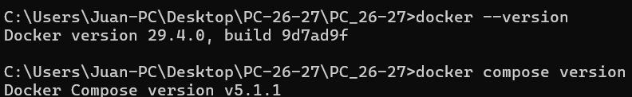

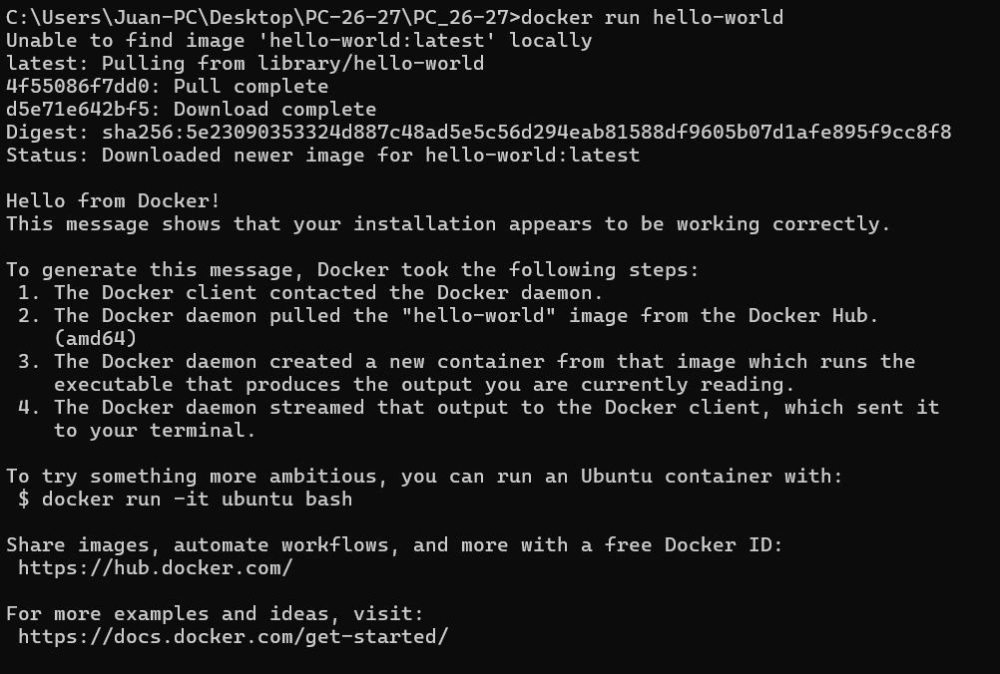

### Parte B — Endpoint de salud

Se añadió Spring Boot Actuator (commit 1) y se expusieron únicamente health e info con management.endpoints.web.exposure.include=health,info. Se limita a esos dos por seguridad: Actuator puede publicar endpoints como env o beans que revelan configuración interna, así que solo se expone lo necesario. show-details=when-authorized oculta los detalles del estado a usuarios no autenticados. Este endpoint es el que usará el healthcheck del Dockerfile, Compose y, más adelante, el pipeline y el despliegue.

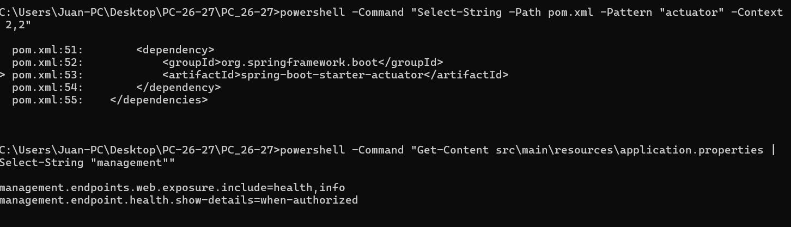


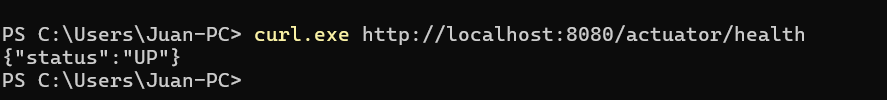

### Parte C — Dockerfile multi-stage

Se creó un Dockerfile en dos etapas (commit 2). La etapa build parte de maven:3.9-eclipse-temurin-21, copia primero el pom.xml y descarga las dependencias, y solo después copia src y compila el JAR. La etapa de runtime parte de eclipse-temurin:21-jre, instala curl solo para el healthcheck, crea un usuario app sin privilegios, copia el JAR desde la etapa anterior y arranca la aplicación con ese usuario. El HEALTHCHECK consulta /actuator/health cada 15 segundos, con 40 segundos de margen al arrancar. El .dockerignore evita enviar target/, .git/, ficheros de IDE y .env al contexto de build.

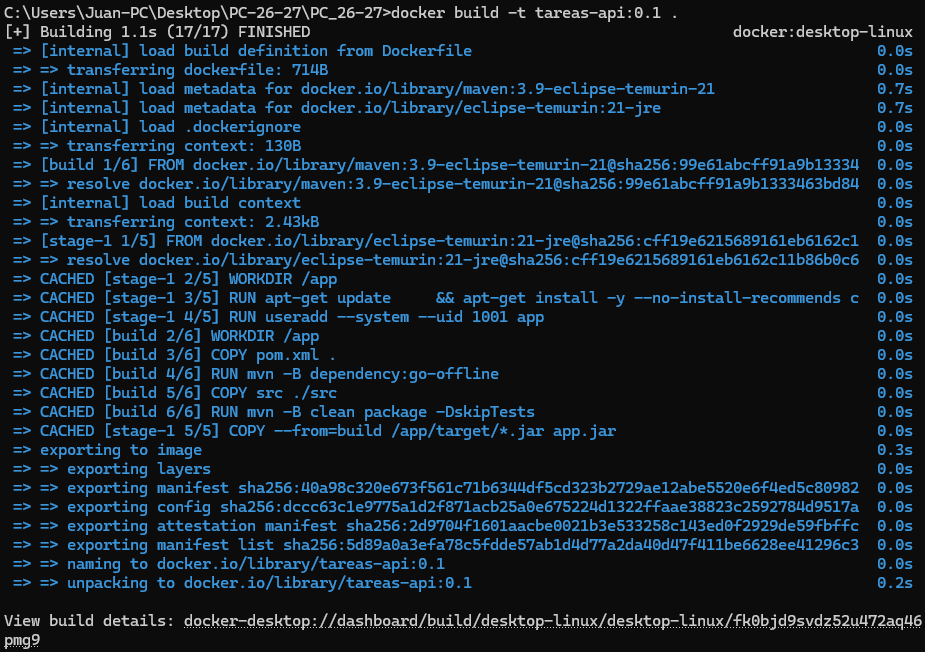

> Contenedor arrancado y `curl.exe http://localhost:8080/api/tasks`.

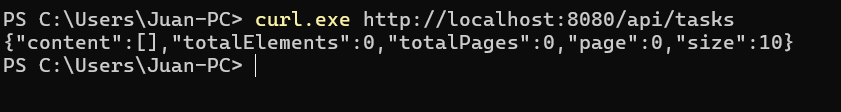


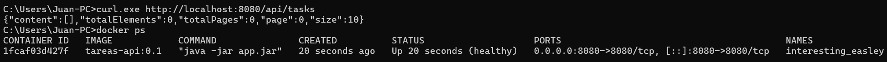

#### Comparación de tamaños

| Imagen | Tamaño |
|---|---|
| `tareas-api:build` | 164 MB |
| `tareas-api:0.1` | 417 MB |

 la imagen build contiene Maven, el JDK completo, las dependencias descargadas en ~/.m2, el código fuente y los ficheros intermedios de compilación; son cientos de MB que solo hacen falta para compilar. La imagen final únicamente incluye el JRE, curl y el JAR, porque la segunda etapa solo copia el resultado con COPY --from=build. El resultado es una imagen mucho más pequeña, que se descarga antes y tiene menos superficie de ataque, ya que cada herramienta que no está en la imagen es una vulnerabilidad menos.

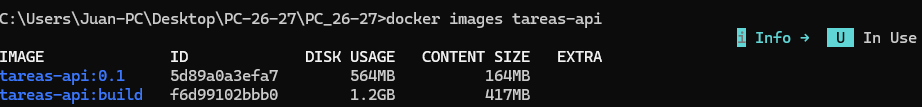

#### Caché de capas

| Orden del Dockerfile | Tiempo (s) |
|---|---|
| Original (`pom.xml` antes que `src`) | 68 |
| Invertido (`src` antes que `pom.xml`) | 77 |

Docker reutiliza una capa mientras su instrucción y sus entradas no cambien, pero al cambiar una capa invalida todas las siguientes. Con el orden original, editar una clase solo invalida desde COPY src; la capa de dependency:go-offline sigue en caché y solo se recompila, por lo que el build es rápido. Con COPY src antes que COPY pom.xml, cualquier cambio en el código invalida también la capa de descarga de dependencias, así que Maven vuelve a bajar todo en cada build y tarda mucho más. Por eso lo que cambia poco va arriba y lo que cambia mucho, abajo. Tras la prueba, el Dockerfile se dejó en su orden original.

> `Measure-Command` con orden original (`TotalSeconds` visible).

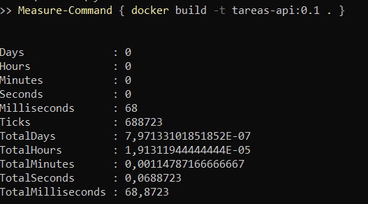

> `Measure-Command` con orden invertido.

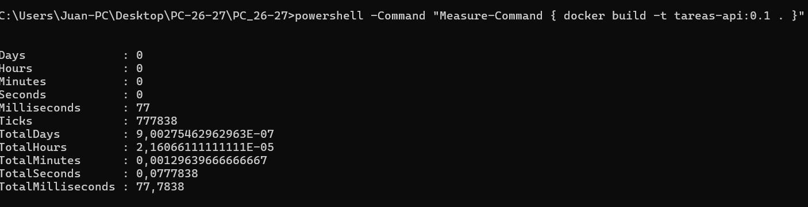

 ---

### Parte D. De H2 a PostgreSQL con Compose

He migrado la aplicación para utilizar una base de datos PostgreSQL en lugar de H2 en memoria, asegurando que los datos persistan aunque los contenedores se detengan o se eliminen. Para ello, he sustituido la dependencia de H2 por el driver de PostgreSQL en el `pom.xml` y he configurado `spring.jpa.hibernate.ddl-auto=update` en `application.properties` para que Hibernate gestione la creación de tablas automáticamente.

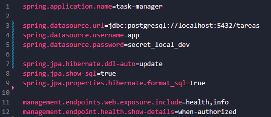

Para orquestar los servicios, he creado un archivo `docker-compose.yml` con dos servicios: `db` y `api`.

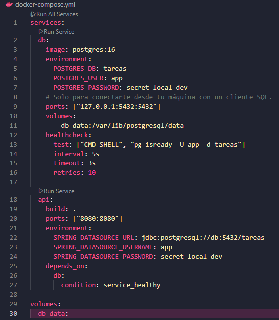

#### Comprobación de la persistencia

He realizado varias pruebas de ciclo de vida para validar el comportamiento de los volúmenes:

1. Inserción de datos: He insertado una tarea mediante una petición POST y he verificado su existencia con un GET.

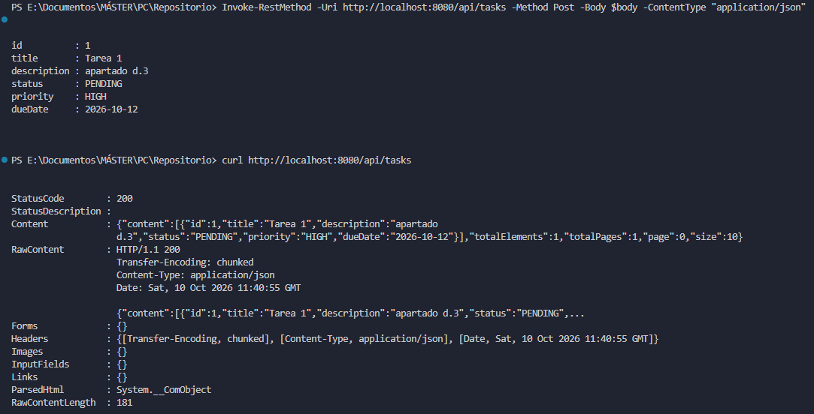

2. Prueba con `docker compose down`: He detenido y eliminado los contenedores. Al ejecutar `docker compose up -d` nuevamente, he comprobado que el dato seguía presente, lo que demuestra que el volumen nombrado `db-data` sobrevive a la eliminación de los contenedores.

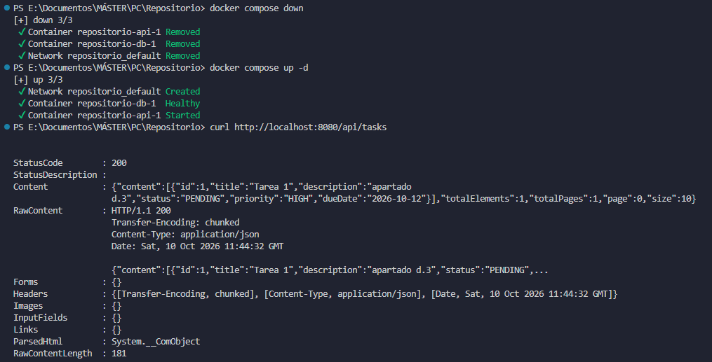

3. Prueba con `docker compose down -v`: He ejecutado el comando con la bandera `-v` (volumes). Al levantar el stack de nuevo, la lista de tareas estaba vacía.

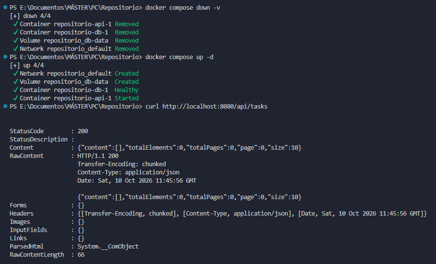

**DIFERENCIA:**
La diferencia fundamental es que `docker compose down` solo elimina los contenedores y la red, manteniendo los volúmenes intactos. En cambio, `docker compose down -v` elimina también los volúmenes, borrando permanentemente todos los datos almacenados en la base de datos.

---

### Parte E. Sacar la configuración a un fichero .env

Para evitar dejar las contraseñas escritas en el código y que no se suban al repositorio, se ha implementado un sistema de variables de entorno. Primero, he creado un archivo `.env.example` que sirve como plantilla para que otros desarrolladores sepan qué variables configurar sin exponer las claves reales.

Para la configuración local, he creado el archivo `.env` con los datos reales, ya estaba añadido al `.gitignore` por tanto solo lo añadí al `.dockerignore` para garantizar que los secretos no se suban al repositorio ni se incluyan en la imagen de Docker.

Después, he modificado el `docker-compose.yml` para sustituir los valores fijos por variables `${VARIABLE}`. He usado la sintaxis `${VAR:?mensaje}` para obligar a que las variables existan y `$${VAR}` en el healthcheck de la base de datos para que la resolución de la variable se haga internamente en el contenedor.

Para verificar la configuración, he usado el comando `docker compose config`, que muestra los valores reales que se van a usar antes de lanzar los contenedores. 

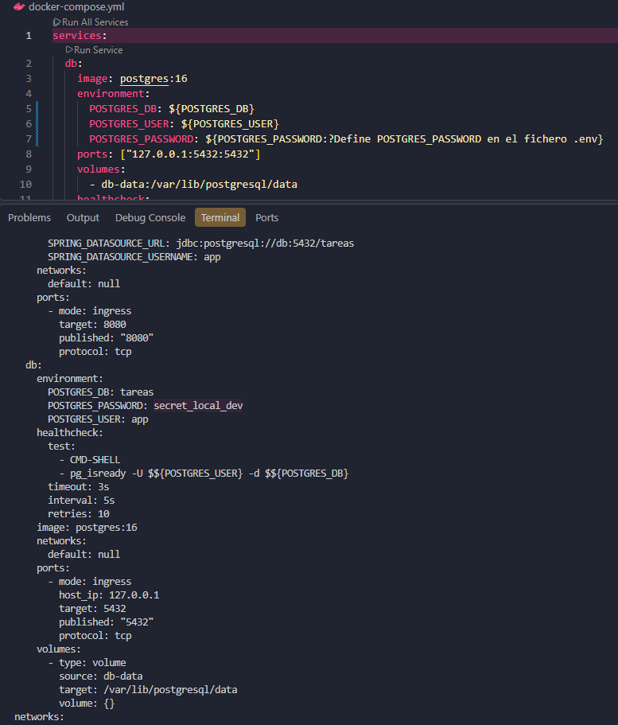 

Por último, he comprobado que la aplicación seguía arrancando correctamente consultando el endpoint `/actuator/health`.

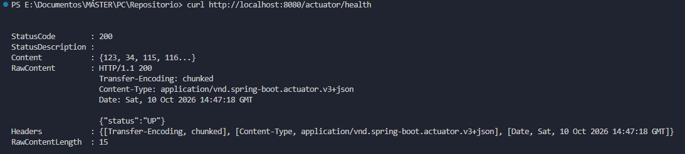 


---

### Parte F. Dev container

He creado el archivo `.devcontainer/devcontainer.json` con la configuración especificada en el boletín.

**Explicación de los campos:**

- Feature `docker-in-docker`: Sirve para poder ejecutar comandos de Docker (como `docker compose up`) desde el interior del propio contenedor de desarrollo.
- Órdenes de `postCreateCommand`:
    1. `test -f .env || cp .env.example .env`: Comprueba si existe el archivo `.env`; si no existe, crea una copia del `.env.example`.
    2. `if [ -d .githooks ]; then git config core.hooksPath .githooks; fi`: Configura la ruta de los hooks de Git si la carpeta `.githooks` está presente.
    3. `mvn -B dependency:go-offline`: Descarga todas las dependencias de Maven para que estén disponibles localmente en el contenedor.

Para validar la implementación, he instalado la extensión "Dev Containers" en VS Code y he usado la opción "Reopen in Container". Una vez dentro del entorno, he ejecutado `docker compose up --build -d` y he comprobando que la API respondía correctamente en `http://localhost:8080/actuator/health`.

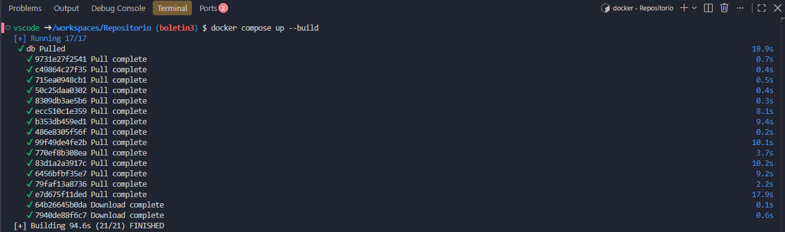 

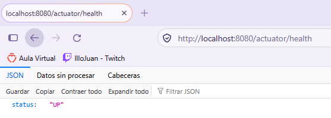 

---

### Parte G — Versionar los cambios

Se documentó en el README cómo levantar el proyecto con Docker (copiar `.env.example` a `.env`, ejecutar `docker compose up --build -d`, comprobar `/actuator/health` y la diferencia entre `down` y `down -v`) y con Dev Container (extensión Dev Containers, `Reopen in Container` y `docker compose up --build -d` dentro del contenedor). Se creó la rama `docs/readme-docker` a partir de `boletin3` y se abrió el [Pull Request #15](https://github.com/SergioAntonLopezumu/PC_26-27/pull/15) hacia `main` con los 6 commits del boletín: `Dockerfile`, `.dockerignore`, `docker-compose.yml`, `.env.example`, `.gitignore` (con `.env`), `pom.xml`, `application.properties`, `.devcontainer/devcontainer.json` y `README.md`. La descripción sigue la plantilla del repositorio; no se enlazó ninguna issue porque el enunciado no la pide, y como solo cambia documentación no se añadieron tests.

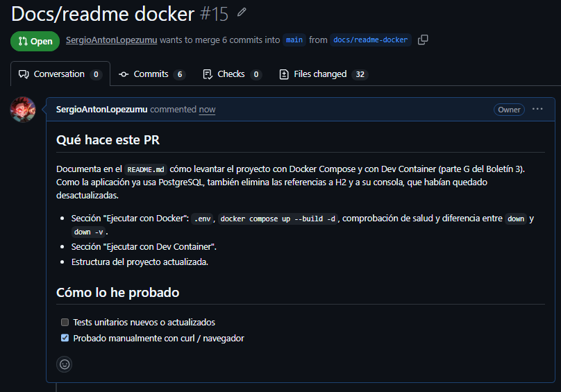

El PR tenía un conflicto en .github/CODEOWNERS, porque main había avanzado (búsqueda por rango de fechas y cambio de code owners) desde que se creó boletin3. Se resolvió fusionando main en la rama del PR (commit 1e8a358). El PR fue revisado y aprobado por SwagDogeMan y fusionado en main el 2026-10-19 a las 19:16 (hora de España) con un merge commit (d7fb673), no con squash, así que los commits 1 a 6 conservan su hash y autoría en el historial de main.

---

### Parte H — Registry de Docker

Docker Hub es un registry público donde se publican imágenes para poder descargarlas desde cualquier máquina. Los pasos fueron:

1. Crear cuenta en Docker Hub (usuario `sergioanton`). El repositorio `tareas-api` se crea al hacer el primer `push`.
2. Iniciar sesión desde la terminal con `docker login`. Abre el navegador para confirmar un código de un solo uso y termina con `Login Succeeded`.

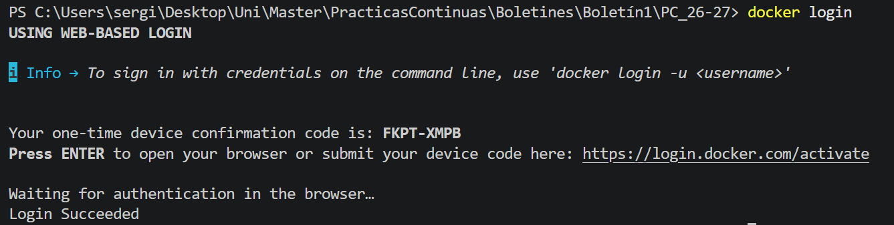

3. Etiquetar la imagen con el nombre `usuario/repositorio:etiqueta`:
   `docker tag tareas-api:0.1 sergioanton/tareas-api:0.1`
4. Subirla con `docker push sergioanton/tareas-api:0.1`. Docker sube cada capa de la imagen (`Pushed`) y al final muestra el digest `sha256:ea5569352cc934f1d8e9677c2a67bed2cdcb0f11f13b644b7f01adee55846bc6`.

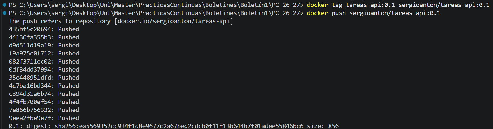

5. Comprobar que se descarga: se borró la copia local con `docker rmi sergioanton/tareas-api:0.1` y se ejecutó `docker pull sergioanton/tareas-api:0.1`, que descargó la imagen con el mismo digest. `docker images sergioanton/tareas-api` la muestra de nuevo en local.

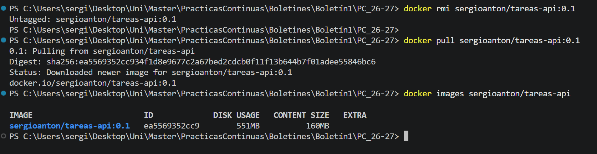

La etiqueta con el prefijo del usuario es obligatoria porque Docker usa ese nombre para saber a qué registry y a qué repositorio subir la imagen. La imagen publicada está en https://hub.docker.com/r/sergioanton/tareas-api. Esta parte no modifica el repositorio del proyecto.


---

### Parte I — Entorno de pruebas reproducible

**Repositorio elegido:** [psf/requests](https://github.com/psf/requests), la librería HTTP más usada de Python (54.512 estrellas). Tiene una batería de unos 630 tests.

**Análisis de requisitos** (fuentes: `pyproject.toml` y `requirements-dev.txt` del repositorio):

| Requisito | Valor | Fuente |
|---|---|---|
| Lenguaje y versión | Python 3.10 o superior (se usa 3.12) | `pyproject.toml` (`requires-python = ">=3.10"`) |
| Gestor de paquetes / build | pip | `pyproject.toml` y `requirements-dev.txt` |
| Dependencias de ejecución | charset_normalizer, idna, urllib3, certifi, PySocks | `pyproject.toml` (`dependencies`) y `requirements-dev.txt` (`-e .[socks]`) |
| Dependencias de test | pytest, pytest-httpbin 2.1.0, httpbin 0.10, trustme, pytest-mock, pytest-xdist | `pyproject.toml` (`optional-dependencies.test`) y `requirements-dev.txt` |
| Dependencias del sistema | Ninguna: los tests levantan un servidor httpbin local | Comprobado al ejecutar los tests en `python:3.12-slim` |
| Comando de tests | `pytest` | `pyproject.toml` (`[tool.pytest.ini_options]`, `testpaths = ["tests"]`) |

**Dockerfile:**

```dockerfile
FROM python:3.12-slim

WORKDIR /app

RUN pip install --no-cache-dir \
    charset_normalizer idna "urllib3>=1.26,<3" certifi PySocks \
    "pytest>=3,<10" pytest-httpbin==2.1.0 "httpbin~=0.10.0" \
    trustme pytest-mock pytest-xdist

ENV PYTHONPATH=/app/src

CMD ["pytest", "-q"]

```

La imagen base `python:3.12-slim` cumple la versión mínima y es ligera. El Dockerfile solo instala las dependencias; el código no se copia a la imagen, se monta con `-v` al ejecutar. `PYTHONPATH=/app/src` permite importar `requests` desde el código montado sin instalarlo, y `CMD` fija `pytest` como comando por defecto.

**Construcción y ejecución:** se clonó el repositorio en una carpeta fuera del proyecto, se construyó la imagen con `docker build -t requests-tests .` y se ejecutaron los tests con `docker run --rm -v "${PWD}\requests:/app" requests-tests`, montando el código fuente sin copiarlo a la imagen.

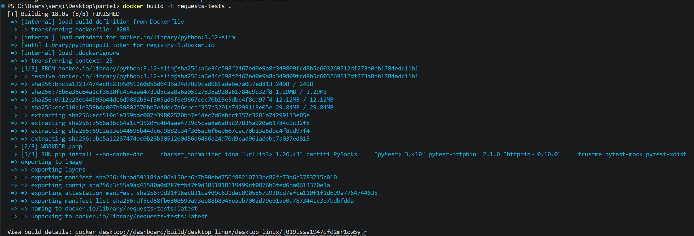

**Problema encontrado.** En la primera ejecución falló un test (`test_different_connection_pool_for_tls_settings_verify_bundle_unexpired_cert`) con `OSError: Could not find a suitable TLS CA certificate bundle, invalid path: tests/certs/valid/ca/ca.crt`. La causa no está en el Dockerfile: en el repositorio `tests/certs/valid/ca` es un enlace simbólico a `../expired/ca`, y al clonar en Windows Git no puede crear enlaces simbólicos sin privilegios, así que lo deja como un fichero de texto de 13 bytes con la ruta. Se solucionó sustituyendo ese fichero por una copia de la carpeta a la que apunta (`Remove-Item tests\certs\valid\ca; Copy-Item -Recurse tests\certs\expired\ca tests\certs\valid\ca`). Solo afecta al clon local, fuera del repositorio del proyecto.

**Resultado:** tras el arreglo, la ejecución termina con `619 passed, 15 skipped, 1 xfailed, 18 warnings in 82.73s`: 0 fallos. Los tests `skipped` y `xfailed` son los que el propio proyecto marca como omitidos o como fallo esperado.

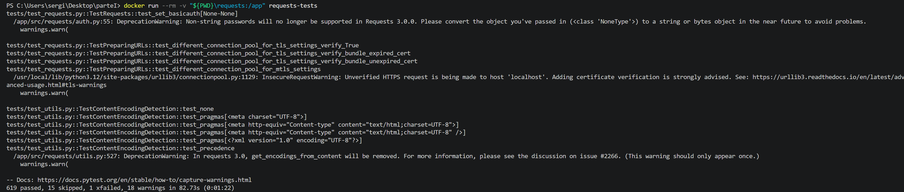


