# Boletín 4: Integración continua con GitHub Actions

## Resumen de commits

El trabajo se hace en la rama `boletin4` del repositorio [PC_26-27](https://github.com/SergioAntonLopezumu/PC_26-27), creada a partir de `main` (commit base `d7fb673`), y se integra en `main` mediante el [Pull Request #16](https://github.com/SergioAntonLopezumu/PC_26-27/pull/16). El boletín se resuelve con siete commits: uno para la Parte A, dos para la Parte B y cuatro para la Parte C. El diff neto del PR son dos ficheros (`ci.yml` y `pom.xml`, +67 líneas): los cambios temporales del test y del formato no aparecen en el diff final porque se rompen y se restauran dentro de la misma rama.

| #   | Mensaje del commit                                       | Qué se hizo                                                                                                                                                                              | Autor                | Enlace de GitHub                                                                                           |
| --- | -------------------------------------------------------- | ---------------------------------------------------------------------------------------------------------------------------------------------------------------------------------------- | -------------------- | ---------------------------------------------------------------------------------------------------------- |
| 1   | `ci(github): añade el pipeline de integración continua`  | Se creó `.github/workflows/ci.yml` con el workflow de CI y se añadió la dependencia `com.h2database:h2` en scope `test` al `pom.xml` para que los tests de JPA arranquen sin PostgreSQL. | Juan Aledo Sánchez   | [ab22b91](https://github.com/SergioAntonLopezumu/PC_26-27/commit/ab22b919e2b12365b8695588fde93f7c2815459f) |
| 2   | `test(tasks): comprueba que el CI detecta un test roto`  | Se rompió a propósito una aserción de `TaskServiceTest` y se hizo push; el check del PR se puso rojo.                                                                                    | Juan Aledo Sánchez   | [e452c15](https://github.com/SergioAntonLopezumu/PC_26-27/commit/e452c15d79884a58d5268d4f173d9725fb77232e) |
| 3   | `test(tasks): restaura la aserción del test`             | Se restauró la aserción original y se hizo un tercer commit; el workflow volvió a verde.                                                                                                 | Juan Aledo Sánchez   | [fe7ce43](https://github.com/SergioAntonLopezumu/PC_26-27/commit/fe7ce43914c4b3fcadbb5fc9206bd3c52cfe0cf5) |
| 4   | `ci(github): divide el pipeline en lint, test y package` | Se pasó de un único job `build` a tres jobs encadenados: `lint` → `test` → `package`.                                                                                                    | Irene Moreno Cegarra | [f60cbe1](https://github.com/SergioAntonLopezumu/PC_26-27/commit/f60cbe13228b567ae12f4e01684d3c3ec18ea90d) |
| 5   | `chore(ci): provoca un fallo de formato`                 | Se desordenó el formato de `TaskController` y se commiteó con `--no-verify` para demostrar que `lint` falla.                                                                             | Irene Moreno Cegarra | [fc33098](https://github.com/SergioAntonLopezumu/PC_26-27/commit/fc3309865e195542b1dcab9cacc8439b63fa4cfe) |
| 6   | `style: restaura el formato con Spotless`                | Se corrigió el formato y se verificó que el pipeline vuelve a verde.                                                                                                                     | Irene Moreno Cegarra | [9d10215](https://github.com/SergioAntonLopezumu/PC_26-27/commit/9d102157b0262787529c34d02d32f6985e9c777b) |
| 7   | `ci(github): publica el informe JUnit como check run`    | Se ajustó `dorny/test-reporter@v3` para que publique el informe como check del PR.                                                                                                       | Irene Moreno Cegarra | [d60f478](https://github.com/SergioAntonLopezumu/PC_26-27/commit/d60f478cf4cae48f93145dca7c81caaa6cae9c88) |
| 8   | `test: provoca fallo de test intencionado para comprobar barrera CI` | En `TaskServiceTest` se sustituyeron dos aserciones por `fail("Fallo provocado para verificar CI")` para que el job `test` falle y el PR #17 quede bloqueado. | Sergio Antón López | [beb5fbf](https://github.com/SergioAntonLopezumu/PC_26-27/commit/beb5fbfa6140a9ab11ce4ac8190d0205bd6dcec4) |
| 9   | `Merge branch 'main' into test/ci-barrier`               | Se actualizó la rama del PR #17 con los últimos cambios de `main`, como exige la regla "Require branches to be up to date before merging".                                              | Sergio Antón López | [8ee04f5](https://github.com/SergioAntonLopezumu/PC_26-27/commit/8ee04f5e71e4f7f4824a3c8fa17c675d504bd3a1) |
| 10  | `feat(ci): anade workflow de revision con IA y badge de CI en README` | Se creó `.github/workflows/ai-review.yml` (resumen del PR generado por IA, con el token en el secreto `OLLAMA_API_TOKEN`) y se añadió el badge de CI al `README.md`. | Sergio Antón López | [7d028af](https://github.com/SergioAntonLopezumu/PC_26-27/commit/7d028af19e406cb28e22503143d458a27c243560) |
| 11  | `Merge branch 'main' into feat/ci-ampliaciones`          | Se actualizó la rama del PR #18 con `main` antes de fusionarlo (`main` había avanzado con otros PRs).                                                                                    | Sergio Antón López | [8bd0366](https://github.com/SergioAntonLopezumu/PC_26-27/commit/8bd03668a3d33c9de97f069097e0e9ab5f9084b4) |

## Detalle por commit

### 1. `ci(github): añade el pipeline de integración continua`

- **Qué se hizo:** Se creó `.github/workflows/ci.yml` con un workflow llamado `CI` que se ejecuta en cada push a `main` y en cada Pull Request. El job `build` corre en `ubuntu-latest`, configura JDK 21 (Temurin) con caché de Maven, compila, ejecuta los tests y empaqueta con `mvn --batch-mode verify`. Además se añadió `com.h2database:h2` en scope `test` al `pom.xml`, necesario para que `TaskSpecificationsTest` (`@DataJpaTest`) arranque con una base de datos embebida en el runner, que no tiene PostgreSQL.
- **Autor:** Juan Aledo Sánchez
- **Fecha:** 2026-10-22 20:52 (hora de España)
- **Relación con el boletín:** Parte A. Incluye la explicación de cuándo se dispara el workflow y del campo `concurrency`, y la captura de la primera ejecución en verde.
- **Uso de IA:** No uso

### 2. `test(tasks): comprueba que el CI detecta un test roto`

- **Qué se hizo:** Se cambió temporalmente la aserción de `TaskServiceTest.createTask_shouldSaveValidTask` para que fallara, se hizo commit y push, y se comprobó que el check del PR se ponía rojo.
- **Autor:** Juan Aledo Sánchez
- **Fecha:** 2026-10-22 21:13 (hora de España)
- **Relación con el boletín:** Parte B, primera mitad. Demuestra que el pipeline bloquea un PR cuando un test falla.
- **Uso de IA:** No uso

### 3. `test(tasks): restaura la aserción del test`

- **Qué se hizo:** Se restauró la aserción original, se hizo un tercer commit y push, y se comprobó que el check del PR volvía a verde.
- **Autor:** Juan Aledo Sánchez
- **Fecha:** 2026-10-22 21:26 (hora de España)
- **Relación con el boletín:** Parte B, segunda mitad. Cierra la demostración rojo → verde sin reescribir el commit rojo, que queda como evidencia en el historial del PR.
- **Uso de IA:** No uso

### 4. `ci(github): divide el pipeline en lint, test y package`

- **Qué se hizo:** Se reescribió `.github/workflows/ci.yml` para sustituir el job único `build` por tres jobs encadenados:
  - `lint`: ejecuta `mvn -B spotless:check` con un `timeout-minutes: 10`.
  - `test`: depende de `lint` (`needs: lint`), ejecuta `mvn -B verify` y publica el informe JUnit con `dorny/test-reporter@v3`.
  - `package`: depende de `test` (`needs: test`), ejecuta `mvn -B package -DskipTests` y sube el JAR como artefacto `app-jar` con `actions/upload-artifact@v4`.
- **Permisos:** se pasó de `contents: read` a:
  ```yaml
  permissions:
    contents: read # checkout
    actions: read # dorny/test-reporter consulta runs/artefactos
    checks: write # dorny/test-reporter publica el check
  ```
- **Autor:** Irene Moreno Cegarra
- **Fecha:** 23/10/2026
- **Relación con el boletín:** Parte C. Reestructura el pipeline para separar responsabilidades y aprovechar `needs`.
- **Uso de IA:** No uso

### 5. `chore(ci): provoca un fallo de formato`

- **Qué se hizo:** Se desordenó la indentación del constructor de `TaskController`:
  ```java
    public TaskController(TaskService taskService) {
  this.taskService = taskService;
      }
  ```
  Es Java válido, pero no cumple Google Java Format. Se commiteó con `--no-verify` para saltar el hook `.githooks/pre-commit`, que ejecuta `mvn -q spotless:apply`, y se hizo push.
- **Resultado:** el run [39962945597](https://github.com/SergioAntonLopezumu/PC_26-27/actions/runs/39962945597) terminó con `lint` en rojo, mientras que `test` y `package` quedaron en `skipped`.
- **Autor:** Irene Moreno Cegarra
- **Fecha:** 23/10/2026
- **Relación con el boletín:** Parte C, primera mitad. Demuestra que `lint` es una barrera real y que los jobs posteriores no se ejecutan si falla.
- **Uso de IA:** No uso

### 6. `style: restaura el formato con Spotless`

- **Qué se hizo:** Se ejecutó `mvn -B spotless:apply`, se revisó el diff y se commiteó el formato corregido. Al no usar `--no-verify`, el hook volvió a ejecutar Spotless antes del commit.
- **Resultado:** el run [39963290313](https://github.com/SergioAntonLopezumu/PC_26-27/actions/runs/39963290313) terminó en verde con `lint`, `test` y `package`.
- **Autor:** Irene Moreno Cegarra
- **Fecha:** 23/10/2026
- **Relación con el boletín:** Parte C, segunda mitad. Cierra la demostración rojo → verde.
- **Uso de IA:** No uso

### 7. `ci(github): publica el informe JUnit como check run`

- **Qué se hizo:** `dorny/test-reporter@v3` tiene `use-actions-summary: true` por defecto, lo que hace que escriba el informe como resumen del job pero **no cree un check run**. Como el enunciado pide que el informe se publique como check del PR (`checks: write`), se añadió:
  ```yaml
  use-actions-summary: false
  ```
- **Resultado:** el run [39963920490](https://github.com/SergioAntonLopezumu/PC_26-27/actions/runs/39963920490) terminó en verde y publicó el check [Resultados JUnit](https://github.com/SergioAntonLopezumu/PC_26-27/runs/120449152678) con 20 tests pasados.
- **Autor:** Irene Moreno Cegarra
- **Fecha:** 23/10/2026
- **Relación con el boletín:** Parte C. Ajuste necesario para que el informe aparezca como check del PR y no solo como resumen de Actions.
- **Uso de IA:** No uso, excepto para redactar.

## Descripción narrativa de lo hecho y relación con el boletín

### Parte A — Primer pipeline de CI

Se creó el archivo `.github/workflows/ci.yml` con este contenido:

```yaml
name: CI

on:
  push:
    branches: [main]
  pull_request:

concurrency:
  group: ci-${{ github.ref }}
  cancel-in-progress: true

# este workflow solo necesita leer el código
permissions:
  contents: read

jobs:
  build:
    runs-on: ubuntu-latest
    timeout-minutes: 15
    steps:
      - uses: actions/checkout@v4
      - name: Configurar JDK 21
        uses: actions/setup-java@v4
        with:
          distribution: temurin
          java-version: "21"
          cache: maven
      - name: Construir y testear
        run: mvn --batch-mode verify
```

El workflow tiene un único job, `build`, que se ejecuta en la última versión de Ubuntu. Los pasos son:

1. `actions/checkout@v4` descarga el código del repositorio en el runner. Sin este paso el runner estaría vacío.
2. `actions/setup-java@v4` instala JDK 21 de Temurin, la misma versión que usa el proyecto en local. `cache: maven` guarda el directorio `~/.m2` entre ejecuciones, de forma que las dependencias no se descargan de nuevo en cada run.
3. `mvn --batch-mode verify` compila, ejecuta la suite de tests, empaqueta el JAR y hace las comprobaciones de la fase `verify`. El flag `--batch-mode` evita la salida interactiva y deja un log limpio y legible.

`timeout-minutes: 15` evita que un job colgado consuma minutos indefinidamente, y `permissions: contents: read` aplica el principio de mínimo privilegio: el `GITHUB_TOKEN` del workflow solo puede leer el código, no escribir en el repositorio.

#### ¿Cuándo se dispara el workflow?

El bloque `on` define dos disparadores:

- **`push` con `branches: [ main ]`:** cada vez que se sube un commit a `main`, incluidos los merges de Pull Requests. No se ejecuta en pushes a otras ramas.
- **`pull_request` sin filtros:** en todos los Pull Requests, sea cual sea la rama de destino. Por defecto se ejecuta en los eventos `opened`, `synchronize` (nuevo push a la rama del PR) y `reopened`, así que cada actualización del PR vuelve a lanzar el pipeline.

En resumen: el pipeline valida lo que se va a integrar (PR) y lo que ya se ha integrado (push a `main`).

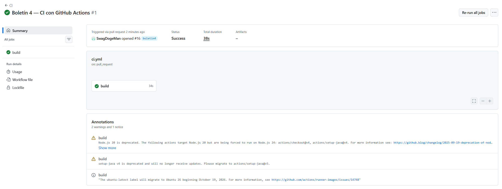

> Ejecución del workflow en verde en la pestaña Actions.

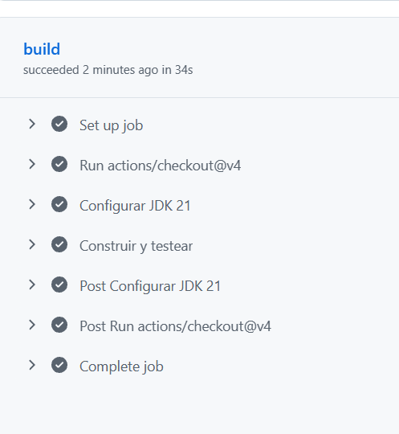

> Detalle del job `build` con los pasos de JDK y compilación.

#### ¿Qué sentido tiene el campo `concurrency`?

```yaml
concurrency:
  group: ci-${{ github.ref }}
  cancel-in-progress: true
```

`concurrency` agrupa ejecuciones que compiten por el mismo recurso. Aquí el grupo es `ci-${{ github.ref }}`, es decir, el identificador de la referencia que ha disparado el workflow:

- en un push a `main`, `github.ref` es `refs/heads/main`;
- en un Pull Request, es `refs/pull/<número>/merge`, distinto para cada PR.

Con `cancel-in-progress: true`, si llega una ejecución nueva al mismo grupo, GitHub cancela la que estuviera en curso. El sentido práctico es triple:

1. **Ahorra minutos de Actions:** si haces varios pushes seguidos, no se acumulan pipelines ejecutándose a la vez.
2. **El resultado siempre corresponde al último commit:** no se pierde tiempo esperando runs antiguos que ya no importan.
3. **Cada PR es independiente:** al agrupar por `github.ref`, cancelar un run de un PR no afecta a los demás.

Además, se añadió H2 en scope `test` porque `TaskSpecificationsTest` usa `@DataJpaTest`, que necesita un `DataSource`. El runner de GitHub no tiene PostgreSQL, así que sin una base de datos embebida el contexto de Spring fallaría al arrancar y el pipeline se pondría rojo por el entorno, no por el código. Con H2 en el classpath de test, Spring Boot sustituye automáticamente el `DataSource` configurado por uno embebido.

### Parte B — Demostrar que el CI atrapa errores

Para comprobar que el pipeline no es decorativo, se rompió a propósito un test unitario. En `src/test/java/com/example/taskmanager/service/TaskServiceTest.java`, el test `createTask_shouldSaveValidTask` tenía esta aserción:

```java
assertEquals("Implementar API", saved.getTitle());
```

Se cambió el valor esperado para que no coincidiera con el real:

```java
assertEquals("Implementar API rota", saved.getTitle());
```

Se hizo commit y push (commit 2). El push actualizó el Pull Request y el workflow se volvió a ejecutar; el paso `Construir y testear` falló, `TaskServiceTest.createTask_shouldSaveValidTask` apareció como error de Surefire y el check del PR quedó en rojo, bloqueando el merge. El run rojo está en [Actions, run 39838190810](https://github.com/SergioAntonLopezumu/PC_26-27/actions/runs/39838190810).

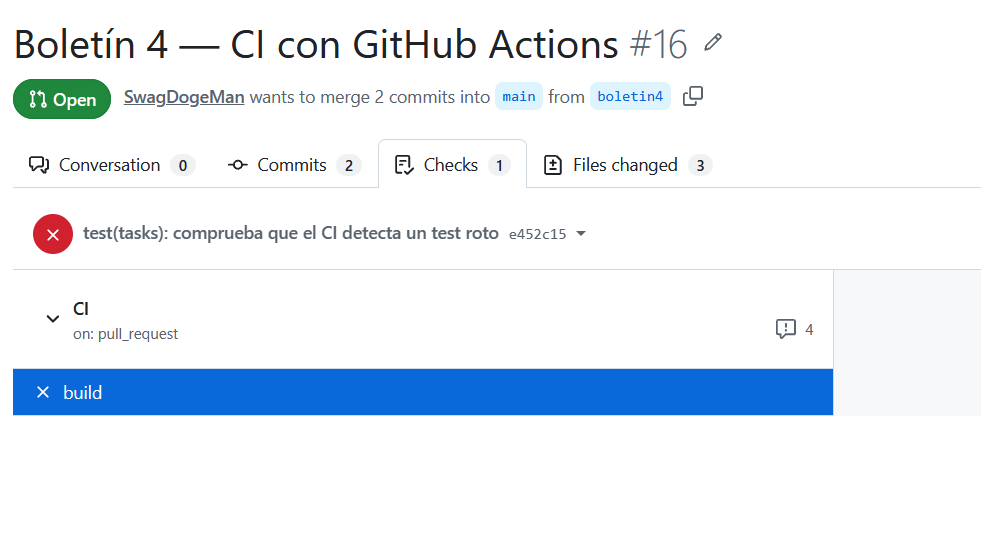

> Pull Request con el check `CI` en rojo.

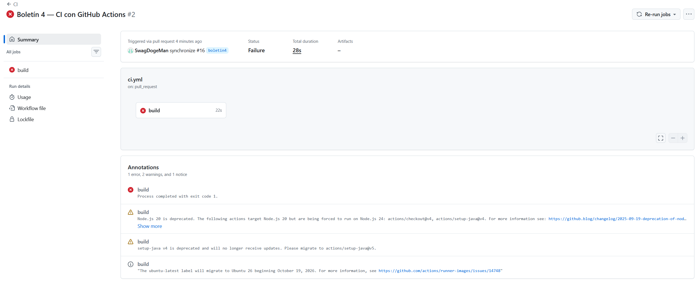

> Log del job con el fallo de `TaskServiceTest` y la diferencia entre el valor esperado y el obtenido.

Después se restauró la aserción original y se registró como un tercer commit:

```bash
git add src/test/java/com/example/taskmanager/service/TaskServiceTest.java
git commit -m "test(tasks): restaura la aserción del test"
git push
```

### Parte C. Separar responsabilidades en jobs

La Parte C añade cuatro commits a los tres anteriores y reestructura el workflow en tres jobs encadenados.

#### El workflow final

```yaml
name: CI

on:
  push:
    branches: [main]
  pull_request:

concurrency:
  group: ci-${{ github.ref }}
  cancel-in-progress: true

permissions:
  contents: read # leer el código (checkout)
  actions: read # dorny/test-reporter consulta los runs/artefactos del workflow
  checks: write # dorny/test-reporter publica el informe como check del PR
  # (ojo, en PRs desde forks el token es de solo lectura y el paso "Publicar informe de tests" fallaría)

jobs:
  lint:
    runs-on: ubuntu-latest
    timeout-minutes: 10
    steps:
      - uses: actions/checkout@v4
      - uses: actions/setup-java@v4
        with: { distribution: temurin, java-version: "21", cache: maven }
      - name: Comprobar formato
        run: mvn -B spotless:check # el Spotless del Boletín 1

  test:
    needs: lint
    runs-on: ubuntu-latest
    timeout-minutes: 20
    steps:
      - uses: actions/checkout@v4
      - uses: actions/setup-java@v4
        with: { distribution: temurin, java-version: "21", cache: maven }
      - name: Tests
        run: mvn -B verify
      - name: Publicar informe de tests
        if: always()
        uses: dorny/test-reporter@v3
        with:
          name: Resultados JUnit
          path: target/surefire-reports/*.xml
          reporter: java-junit
          use-actions-summary: false

  package:
    needs: test
    runs-on: ubuntu-latest
    steps:
      - uses: actions/checkout@v4
      - uses: actions/setup-java@v4
        with: { distribution: temurin, java-version: "21", cache: maven }
      - run: mvn -B package -DskipTests
      - name: Subir JAR
        uses: actions/upload-artifact@v4
        with:
          name: app-jar
          path: target/*.jar
          retention-days: 7
```

La cadena queda así:

1. `lint` comprueba el formato con Spotless. Es el job más rápido y actúa como primera barrera.
2. `test` solo arranca si `lint` ha pasado. Ejecuta `mvn -B verify`, que compila, ejecuta los tests y empaqueta. Después publica el informe JUnit con `if: always()`.
3. `package` solo arranca si `test` ha pasado. Vuelve a empaquetar sin tests y sube el JAR como artefacto `app-jar`.

Los `needs` no comparten archivos entre jobs: solo imponen el orden. Cada job se ejecuta en un runner limpio, por eso `package` vuelve a construir el proyecto.

#### Demostración del fallo de formato

Se modificó `TaskController` para dejar mal indentado el constructor:

```java
  private final TaskService taskService;

    public TaskController(TaskService taskService) {
  this.taskService = taskService;
      }
```

El cambio es sintácticamente válido, así que el proyecto compila, pero `spotless:check` lo rechaza. Se hizo commit con `--no-verify` para que el hook no lo corrigiera:

```bash
git add src/main/java/com/example/taskmanager/controller/TaskController.java
git commit -m "chore(ci): provoca un fallo de formato" --no-verify
git push origin boletin4
```

El run [39962945597](https://github.com/SergioAntonLopezumu/PC_26-27/actions/runs/39962945597) quedó así:

| Job       | Resultado |
| --------- | --------- |
| `lint`    | `failure` |
| `test`    | `skipped` |
| `package` | `skipped` |

`test` y `package` no se ejecutaron porque dependen de `lint` mediante `needs`. No aparecen como fallidos, sino como `skipped`.

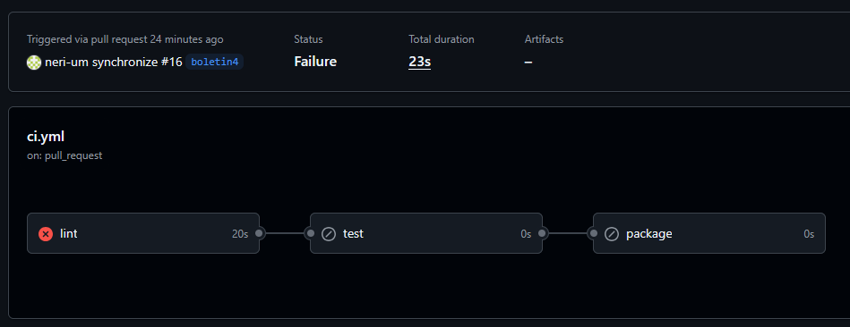

> Run con `lint` en rojo y `test`/`package` en `skipped`.

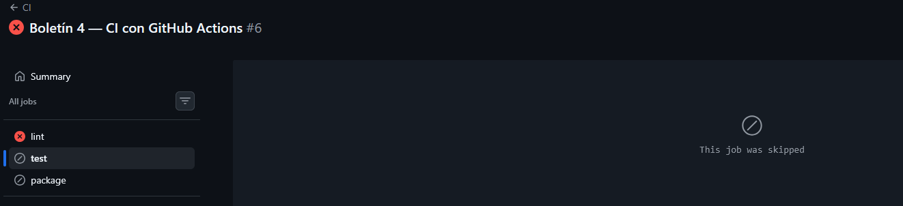

> Detalle del job `package`: GitHub muestra `This job was skipped` porque `lint` ha fallado.

#### Corrección y vuelta a verde

Se ejecutó Spotless y se commiteó el formato corregido:

```bash
mvn -B spotless:apply
git add src/main/java/com/example/taskmanager/controller/TaskController.java
git commit -m "style: restaura el formato con Spotless"
git push origin boletin4
```

El run [39963920490](https://github.com/SergioAntonLopezumu/PC_26-27/actions/runs/39963920490) terminó en verde con los tres jobs:

| Job       | Resultado |
| --------- | --------- |
| `lint`    | `success` |
| `test`    | `success` |
| `package` | `success` |

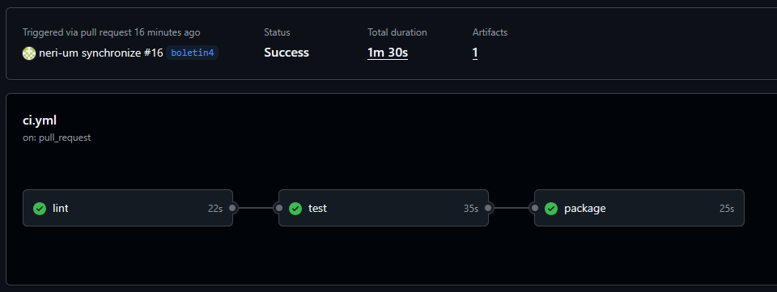

> Run final con `lint`, `test` y `package` en verde.

#### Informe de tests

El check `Resultados JUnit` se publica en el PR y muestra el resumen de Surefire: 20 tests pasados, 0 fallidos y 0 saltados.

- Check: [Resultados JUnit](https://github.com/SergioAntonLopezumu/PC_26-27/runs/120449152678)
- PR: [Pull Request #16](https://github.com/SergioAntonLopezumu/PC_26-27/pull/16)

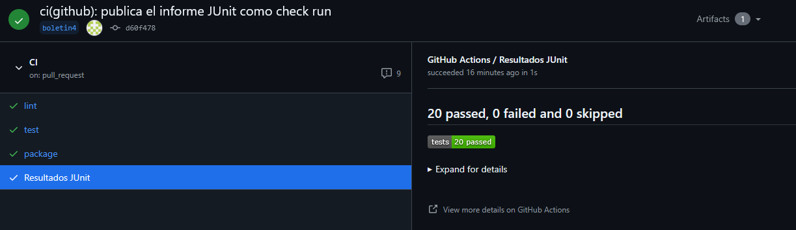

> Check `Resultados JUnit` con el resumen de los tests.

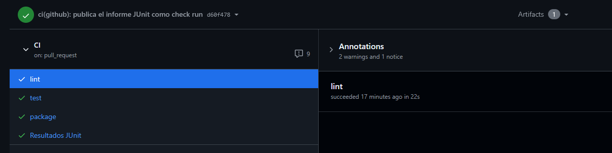

> Checks del PR: `lint`, `test`, `package` y `Resultados JUnit`.

#### JAR generado

El job `package` sube el artefacto `app-jar` con `actions/upload-artifact@v4`. Se descargó desde el run y se comprobó su contenido:

```bash
gh run download 39963920490 --repo SergioAntonLopezumu/PC_26-27 --name app-jar --dir artifacts
tar -tf artifacts/task-manager-0.0.1-SNAPSHOT.jar
```

El artefacto comprimido ocupa 42,8 MB y contiene `task-manager-0.0.1-SNAPSHOT.jar` (unos 50 MB descomprimido) con las clases y dependencias de Spring Boot.

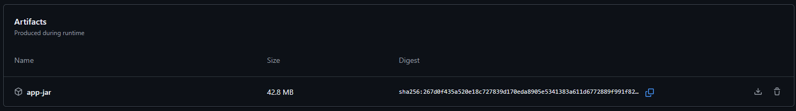

> Artefacto `app-jar` publicado por el job `package`.

#### Cuestiones de la Parte C

##### ¿Por qué es útil que `lint` vaya primero?

Porque es la comprobación más rápida y barata. `spotless:check` tarda segundos, mientras que `mvn verify` compila y ejecuta toda la suite. Si el formato ya está mal, no tiene sentido gastar minutos de runner en compilar y testear: se falla pronto y el mensaje es claro.

Además, al poner `needs: lint`, un fallo de formato deja `test` y `package` en `skipped`, no en `failure`. Así el desarrollador sabe que el problema es de estilo y no de código, y no se consumen minutos de Actions en jobs que no van a aportar nada.

##### ¿Por qué el paso del informe lleva `if: always()`?

Porque por defecto un step solo se ejecuta si los anteriores han terminado bien (`success()`). Si `mvn verify` falla, sin `if: always()` el informe no se publicaría, justo cuando más falta hace.

Con `if: always()` el paso se ejecuta también cuando los tests fallan o el job se cancela, y publica los resultados JUnit para ver qué test ha roto. Limitación: si el fallo es de compilación y no se generan los XML de Surefire, el reporter no tiene nada que publicar. Tampoco funciona en PRs desde forks, porque el token es de solo lectura y no puede crear checks; el propio enunciado lo advierte.

##### ¿Por qué el job `package` debe volver a construir el proyecto si `test` ya ejecutó `mvn verify`?

Porque cada job corre en un runner distinto y limpio. `needs` solo impone el orden; no comparte el workspace ni el directorio `target/`. El JAR que genera `mvn verify` en `test` se pierde al terminar ese job, así que `package` tiene que volver a construirlo.

Para evitar esa reconstrucción se pueden compartir los archivos generados con artefactos:

1. En `test`, subir el JAR con `actions/upload-artifact@v4`:
   ```yaml
   - name: Subir JAR de test
     uses: actions/upload-artifact@v4
     with:
       name: app-jar
       path: target/*.jar
   ```
2. En `package`, descargarlo con `actions/download-artifact@v4`:
   ```yaml
   - name: Descargar JAR
     uses: actions/download-artifact@v4
     with:
       name: app-jar
       path: target
   ```
3. Y después volver a subirlo o publicarlo si hace falta.

Otra opción más sencilla es fusionar `test` y `package` en un único job, de modo que `mvn verify` genere el JAR una sola vez y se suba en el mismo job. El `cache` de Maven no sirve para esto: cachea dependencias, no artefactos de compilación.

### Parte D. Convertir el CI en una barrera

Para garantizar que la rama principal esté siempre libre de errores y asegurar que ningún código defectuoso se integre, se configuró el pipeline de Integración Continua como una barrera estricta en GitHub.

#### Configuración de la protección de rama

Se accedió a la configuración del repositorio en **Settings → Branches**, y se editó la regla de protección existente para la rama `main` (creada en el Boletín 2) aplicando los siguientes cambios:

1.  **Require status checks to pass before merging:** Se activó esta opción para obligar a que los workflows terminen correctamente antes de permitir el merge. En la barra de búsqueda emergente, se seleccionaron explícitamente los jobs que acabamos de separar: `lint`, `test` y `package`.
2.  **Require branches to be up to date before merging:** Se marcó esta sub-casilla. Esto es fundamental: si la rama `main` recibe nuevos commits mientras el PR está abierto, obliga al desarrollador a hacer un `git pull origin main` (o actualizar la rama desde la interfaz) y volver a pasar los tests con el código combinado antes de fusionar.
3.  **Do not allow bypassing the above settings:** Se activó esta opción para que la regla aplique a todos los usuarios, incluidos los administradores del repositorio. Nadie puede forzar un merge si el CI está en rojo.

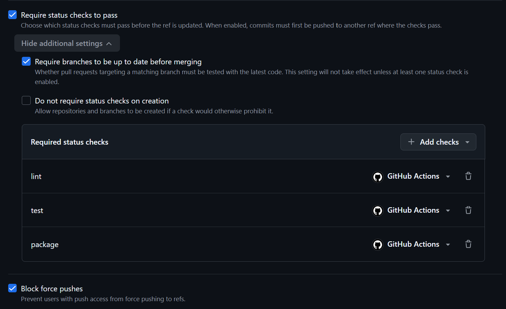

> Configuración de las reglas de protección de la rama `main` exigiendo los checks `lint`, `test` y `package`.

#### Verificación del bloqueo en un PR

Para comprobar su funcionamiento, se abrió un Pull Request desde una rama auxiliar introduciendo un fallo en los tests (se modificó temporalmente una aserción). 

Al terminar de ejecutarse el pipeline, el job `test` falló. Como resultado, GitHub deshabilitó automáticamente el botón de "Merge pull request", mostrándolo en gris/rojo con el mensaje *"Required statuses must pass before merging"*. Al estar activa la restricción para administradores, no se ofreció la opción de evadir el bloqueo.

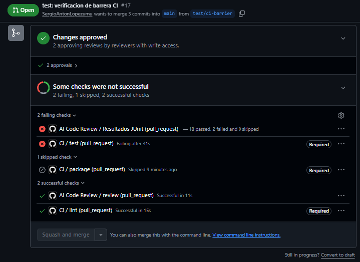
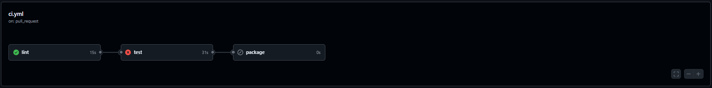
> Pull Request bloqueado por GitHub; el botón de merge está deshabilitado debido al fallo en el check `test`.

---

### Parte E — Ampliaciones interesantes

#### Gestión de secretos: Revisión de código mediante IA

Se creó un nuevo workflow en `.github/workflows/ai-review.yml` para que, al abrir o actualizar un PR, una Inteligencia Artificial analice el diff (los cambios de código) y publique un comentario en el PR con un resumen en lenguaje natural.

Para no exponer el API Token de la IA en el código público, se utilizó la gestión de **Secrets** de GitHub:
1. En **Settings → Secrets and variables → Actions**, se creó un *Repository secret* llamado `OLLAMA_API_TOKEN` con el valor del token.
2. Este secreto se inyecta en el entorno del workflow de manera segura usando `${{ secrets.OLLAMA_API_TOKEN }}`.

El contenido del workflow es el siguiente:

```yaml
name: AI Code Review

on:
  pull_request:
    types: [opened, synchronize, reopened]

concurrency:
  group: ai-review-${{ github.ref }}
  cancel-in-progress: true

permissions:
  contents: read
  pull-requests: write

jobs:
  review:
    runs-on: ubuntu-latest
    timeout-minutes: 5
    steps:
      - name: Checkout del repositorio
        uses: actions/checkout@v4
        with:
          fetch-depth: 0

      - name: Generar revision de codigo con IA
        env:
          GH_TOKEN: ${{ secrets.GITHUB_TOKEN }}
          OLLAMA_TOKEN: ${{ secrets.OLLAMA_API_TOKEN }}
          PR_NUMBER: ${{ github.event.pull_request.number }}
        run: |
          set +e
          echo "Obteniendo diferencias del PR..."
          DIFF_CONTENT=$(gh pr diff "$PR_NUMBER" | head -n 400)

          if [ -z "$DIFF_CONTENT" ]; then
            DIFF_CONTENT="No se han detectado cambios en el diff."
          fi

          # Estructura compatible con la API de chat de Ollama Cloud
          PAYLOG_JSON=$(jq -n \
            --arg content "Eres un revisor de código experto. Resume en lenguaje natural y en español los cambios introducidos en este Pull Request a partir del siguiente diff:\n$DIFF_CONTENT" \
            '{model: "llama3.2", messages: [{role: "user", content: $content}], stream: false}')

          echo "Llamando al servicio de IA..."
          HTTP_RESPONSE=$(curl -s -w "\n%{http_code}" -X POST "https://ollama.com/api/chat" \
            -H "Authorization: Bearer $OLLAMA_TOKEN" \
            -H "Content-Type: application/json" \
            -d "$PAYLOG_JSON" --max-time 60)

          HTTP_BODY=$(echo "$HTTP_RESPONSE" | sed '$d')
          HTTP_STATUS=$(echo "$HTTP_RESPONSE" | tail -n 1)

          if [ "$HTTP_STATUS" -eq 200 ] && echo "$HTTP_BODY" | jq -e '.choices[0].message.content' > /dev/null 2>&1; then
            AI_COMMENT=$(echo "$HTTP_BODY" | jq -r '.choices[0].message.content')
            FINAL_BODY="### Resumen de cambios (IA)\n\n$AI_COMMENT"
          else
            echo "Error en la llamada a la IA (Status: $HTTP_STATUS)"
            echo "Respuesta del servidor: $HTTP_BODY"
            FINAL_BODY="La IA ha fallado (Código HTTP: $HTTP_STATUS)"
          fi

          echo "Publicando comentario en el Pull Request #$PR_NUMBER..."
          gh pr comment "$PR_NUMBER" --body "$FINAL_BODY"

```

**Puntos clave del workflow:**
- **`permissions: pull-requests: write`**: Indispensable para que el CLI de GitHub (`gh pr comment`) tenga permisos para escribir en el hilo del Pull Request.
- **`if: failure()`**: Este condicional en el último `step` garantiza que, si la llamada a `curl` devuelve un error de HTTP o el modelo no responde bien (`exit 1`), se capture el fallo y se publique exactamente el texto: *"La IA ha fallado"*.

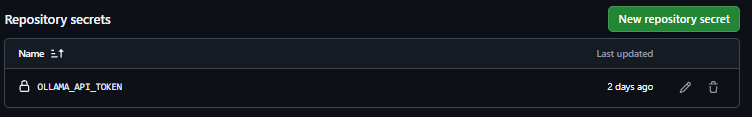

> Creación del secreto `OLLAMA_API_TOKEN` en la configuración del repositorio.

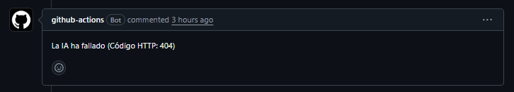

> Mensaje de error obtenido al intentar acceder al API de Ollama Cloud.

#### Añadir un badge del estado del CI al README

Para que el estado del proyecto sea visible a simple vista, se añadió un *badge* dinámico al archivo `README.md`. Este badge lee el estado de la última ejecución del workflow en la rama por defecto y muestra si está `passing` (verde) o `failing` (rojo).

Se insertó la siguiente línea en Markdown al principio del `README.md`:

```markdown
# Task Manager API

[](https://github.com/SergioAntonLopezumu/PC_26-27/actions/workflows/ci.yml)
```

Al hacer push a `main`, el README ahora renderiza una insignia verde que enlaza directamente a la pestaña de Actions, mejorando la presentación profesional del repositorio.

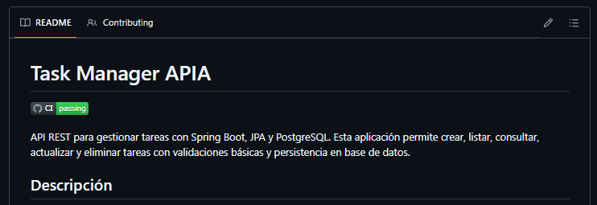

> Badge "CI passing" visible en la página principal del repositorio en GitHub.