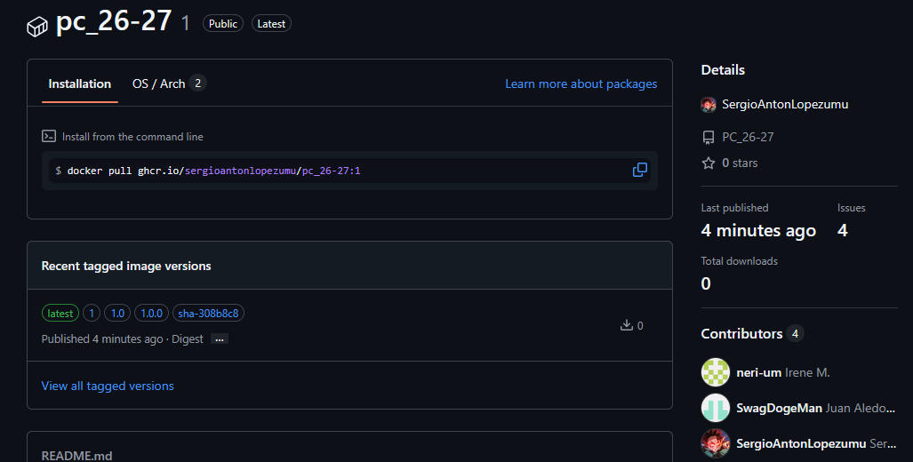
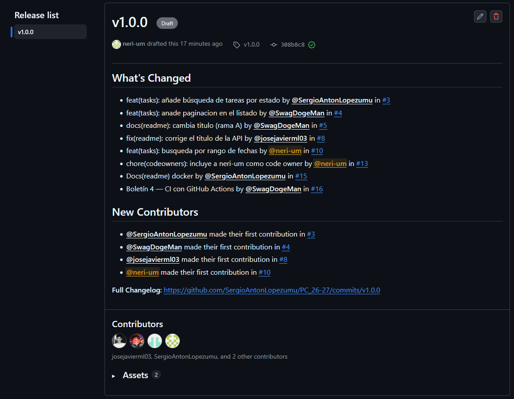
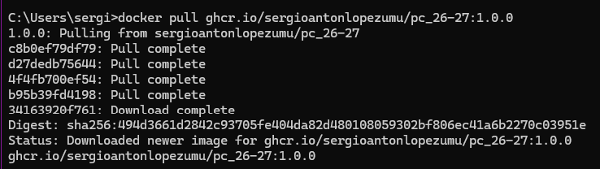
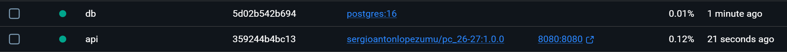
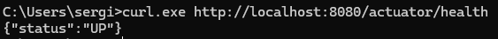
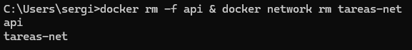
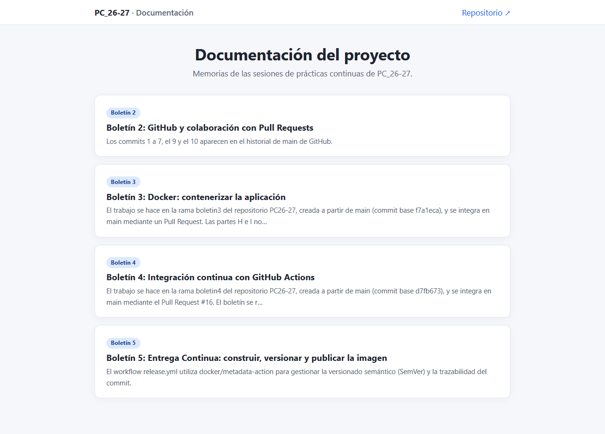
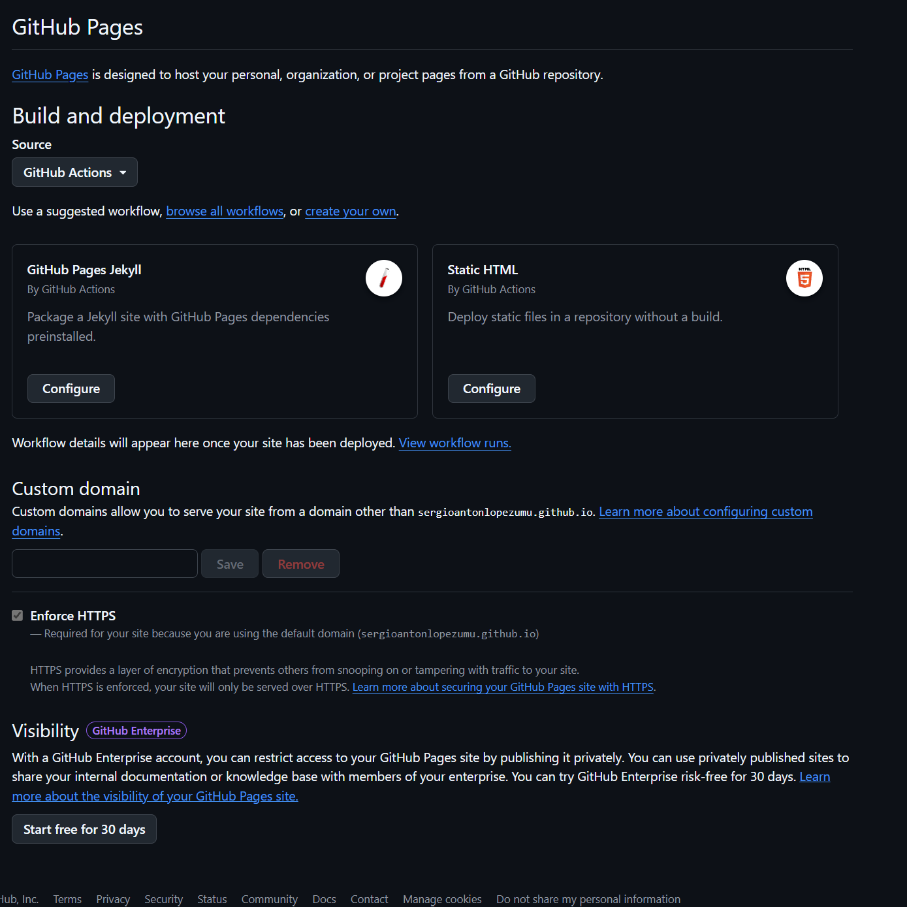

# Boletín 5: Entrega Continua: construir, versionar y publicar la imagen

---

## Resumen de commits

| #   | Mensaje del commit                             | Qué se hizo                                                                      | Autor                | Enlace de GitHub                                                                                           |
| --- | ---------------------------------------------- | -------------------------------------------------------------------------------- | -------------------- | ---------------------------------------------------------------------------------------------------------- |
| 1   | `ci(docker): añade workflow de release a GHCR` | Creación de `.github/workflows/release.yml` para construir y publicar la imagen. | Irene Moreno Cegarra | [aef954b](https://github.com/SergioAntonLopezumu/PC_26-27/commit/aef954b95b13b38263cbd1f20bab98d1bac028b1) |
| 2   | `Primera versión publicable de la API de tareas`      | Creación y subida del tag `v1.0.0` y publicación de la Release.                  | Irene Moreno Cegarra | [v1.0.0](https://github.com/SergioAntonLopezumu/PC_26-27/releases/tag/untagged-3fabd35032f5730f0633)       |
| 3   | `docs(boletin5): añade las memorias y publica la documentación en GitHub Pages` | Commit único de la Parte D: memorias y capturas en `docs/`, generador `docs/generate.mjs`, workflow `pages.yml`, `docs/site/` en `.gitignore` y esta memoria ampliada. | Juan Aledo Sánchez | [historial de `docs/`](https://github.com/SergioAntonLopezumu/PC_26-27/commits/main/docs) |

---

## Detalle por commit

### 1. `ci(docker): añade workflow de release a GHCR`

- **Qué se hizo:** Se creó `.github/workflows/release.yml` configurado para ejecutarse en `push` a `main` y en `tags` (`v*.*.*`). Utiliza `docker/login-action`, `docker/metadata-action` para generar tags trazables y `docker/build-push-action` para construir y subir al registro.
- **Autor:** Irene Moreno Cegarra
- **Fecha:** 25-10-2026
- **Relación con el boletín:** Apartado A.
- **Uso de IA:** No uso.

### 2. `Primera versión publicable de la API de tareas`

- **Qué se hizo:** Se ejecutó el etiquetado y la creación de la _Release_ en GitHub tras verificar que la imagen base estaba disponible en el registro.
- **Autor:** Irene Moreno Cegarra
- **Fecha:** 25-10-2026
- **Relación con el boletín:** Apartado B.
- **Uso de IA:** No uso.

### 3. `docs(boletin5): añade las memorias y publica la documentación en GitHub Pages`

- **Qué se hizo:** Se copiaron a `docs/` las memorias de los boletines 2, 3, 4 y 5 junto con sus capturas, en una subcarpeta por boletín para evitar que las imágenes homónimas se sobrescriban. Se añadió `docs/generate.mjs`, un generador sin dependencias que convierte los Markdown en HTML y crea el índice, y el workflow `pages.yml`, que lo ejecuta y publica `docs/site/` en GitHub Pages. También se ignoró `docs/site/` en `.gitignore` y se amplió esta memoria con la Parte D.
- **Autor:** Juan Aledo Sánchez
- **Fecha:** 26-10-2026
- **Relación con el boletín:** Parte D completa.
- **Uso de IA:** Sí. El script generador y el workflow se redactaron con ayuda de IA y después se revisaron y probaron en local con los cinco documentos.

---

## Descripción narrativa de lo hecho y relación con el boletín

### Parte A. Pipeline de publicación

El workflow `release.yml` utiliza `docker/metadata-action` para gestionar la versionado semántico (SemVer) y la trazabilidad del commit.

#### Cuestiones de la Parte A

1. **Al fusionar un PR a `main`:** Se generan los tags `latest` (versión actual de desarrollo) y `sha-<commit>` (trazabilidad absoluta).
2. **Al publicar una etiqueta `vX.Y.Z`:** Se generan `X.Y.Z`, `X.Y` y `X`. Esto permite a los usuarios fijar la versión exacta o aceptar actualizaciones automáticas compatibles.

La imagen aparece en la pestaña Packages del repositorio, etiquetada con el SHA del commit y con latest.


### Parte B. Publicar una versión de verdad

Se ejecutó `git tag -a v1.0.0 -m "Primera versión publicable de la API de tareas"` y `git push origin v1.0.0`. Tras el pipeline, se creó la Release en GitHub.



### Parte C. Verificar la imagen publicada

Desde el Boletín 3 la aplicación necesita una PostgreSQL real, así que para probar la imagen publicada se reproduce a mano lo que hace `docker-compose.yml`: una red compartida, un contenedor `db` con `postgres:16` y un contenedor `api` con la imagen descargada de GHCR. La API encuentra la base de datos por el nombre del contenedor (`db`) gracias al DNS interno de la red de Docker.

> **Nota:** GHCR exige el nombre de la imagen en minúsculas. `docker/metadata-action` ya convierte `github.repository` a minúsculas, por eso la imagen se llama `ghcr.io/sergioantonlopezumu/pc_26-27`.

Comandos ejecutados desde `cmd` de Windows. Cada comando va en una sola línea, porque en `cmd` no funciona la `\` de Linux para partir líneas y el `;` no separa comandos:

```cmd
docker network create tareas-net

docker run -d --name db --network tareas-net -e POSTGRES_DB=tareas -e POSTGRES_USER=app -e POSTGRES_PASSWORD=secret_local_dev postgres:16

docker pull ghcr.io/sergioantonlopezumu/pc_26-27:1.0.0

docker run -d --name api --network tareas-net -p 8080:8080 -e SPRING_DATASOURCE_URL=jdbc:postgresql://db:5432/tareas -e SPRING_DATASOURCE_USERNAME=app -e SPRING_DATASOURCE_PASSWORD=secret_local_dev ghcr.io/sergioantonlopezumu/pc_26-27:1.0.0

curl http://localhost:8080/actuator/health
```

El `pull` descarga la imagen del registro, no la reconstruye en local. Así se demuestra que el artefacto que genera el pipeline funciona por sí solo:



Ambos contenedores quedan en ejecución dentro de la red `tareas-net`:



El endpoint de salud responde `{"status":"UP"}`, lo que confirma que la aplicación arranca y conecta con PostgreSQL:



Por último, se eliminó todo lo creado:

```powershell
docker rm -f api & docker network rm tareas-net
```



### Parte D. GitHub Pages de la documentación

#### D.1. Traer las memorias al repositorio

Hasta ahora las memorias se guardaban en una carpeta aparte, fuera del repositorio de la API. Se han copiado a `docs/`:

```text
docs/
├── boletin2.md
├── boletin3.md
├── boletin4.md
├── boletin5.md
├── boletin2/   (capturas del boletín 2)
├── boletin3/   (capturas del boletín 3)
├── boletin4/   (capturas del boletín 4)
├── boletin5/   (capturas del boletín 5)
├── generate.mjs
└── site/       (generado, no se sube)
```

Cada memoria conserva sus capturas en una subcarpeta propia porque los nombres se repiten entre boletines: `ParteA1.png` existe tanto en el Boletín 3 como en el 4 con contenido distinto. Si todas las imágenes compartieran `docs/`, unas sobrescribirían a otras. Por eso las rutas del Markdown se reescribieron de `ParteA1.png` a `boletin3/ParteA1.png` (o `boletin4/...` según el caso), de forma que el mismo fichero funciona igual al verlo en GitHub y en la web generada.

No se conservaba una memoria del Boletín 1, así que la documentación publicada empieza en el Boletín 2.

#### D.2. El script generador

`docs/generate.mjs` es un script de Node **sin dependencias externas**, para que el workflow no tenga que instalar nada. Se ejecuta con:

```bash
node docs/generate.mjs
```

El script hace lo siguiente:

1. Borra y recrea `docs/site/` para que no queden restos de ejecuciones anteriores.
2. Busca todos los `.md` de `docs/` y los ordena por número de boletín.
3. Convierte cada uno a HTML: encabezados (con `id` para poder enlazar secciones), párrafos, listas anidadas, bloques de código con su lenguaje, código en línea, tablas, negritas, cursivas, enlaces, imágenes, citas y separadores.
4. Genera `docs/site/<nombre>.html` con una hoja de estilos embebida (sin CDN, así la web funciona aunque no haya red y se ve igual en cualquier navegador), navegación anterior/siguiente y un enlace al repositorio.
5. Genera `docs/site/index.html` con una tarjeta por boletín, su título y un resumen extraído del primer párrafo.
6. Copia las imágenes y demás recursos a `docs/site/`, conservando las subcarpetas para que las rutas relativas sigan siendo válidas.

La salida de una ejecución correcta es:

```text
  ✓ boletin2.md → site/boletin2.html
  ✓ boletin3.md → site/boletin3.html
  ✓ boletin4.md → site/boletin4.html
  ✓ boletin5.md → site/boletin5.html
  ✓ site/index.html
  ✓ 63 recursos copiados a site/

Sitio generado en docs/site
```

**Uso de IA:** sí. El script se generó con ayuda de IA y después se revisó, se ejecutó en local y se corrigieron los casos que fallaban (listas con bloques de código dentro, tablas con formato y rutas de las imágenes).

#### D.3. Prueba en local

Antes de automatizar nada se generó el sitio y se abrió `docs/site/index.html` en el navegador. Se comprobó que el índice enlaza a los cuatro boletines, que las tablas de commits se ven completas, que los bloques de código respetan el formato y que todas las capturas cargan.



#### D.4. El workflow de publicación

`.github/workflows/pages.yml` se ejecuta en cada `push` a `main` y también a mano con `workflow_dispatch`, para poder probarlo sin esperar a un commit:

```yaml
name: Pages

on:
  push:
    branches: [main]
  workflow_dispatch:

permissions:
  contents: read
  pages: write
  id-token: write

concurrency:
  group: pages
  cancel-in-progress: false

jobs:
  build:
    runs-on: ubuntu-latest
    steps:
      - uses: actions/checkout@v4

      - uses: actions/setup-node@v4
        with:
          node-version: "20"

      - name: Generar el sitio
        run: node docs/generate.mjs

      - uses: actions/configure-pages@v5

      - uses: actions/upload-pages-artifact@v3
        with:
          path: docs/site

  deploy:
    needs: build
    runs-on: ubuntu-latest
    environment:
      name: github-pages
      url: ${{ steps.deployment.outputs.page_url }}
    steps:
      - name: Publicar en GitHub Pages
        id: deployment
        uses: actions/deploy-pages@v4
```

Los detalles que importan:

- **`permissions`:** `pages: write` permite publicar en Pages e `id-token: write` es necesario para que `deploy-pages` use el token OIDC de GitHub. `contents: read` basta para el `checkout`.
- **`concurrency`:** agrupa todas las ejecuciones en `pages` y no cancela la que esté en curso (`cancel-in-progress: false`), para no dejar una publicación a medias.
- **Dos jobs:** `build` genera el sitio y lo sube como artefacto de Pages; `deploy` lo publica. Separarlos permite ver en el resumen del run qué se ha generado antes de desplegarlo y repetir solo el despliegue si hiciera falta.
- **`actions/upload-pages-artifact`:** sube `docs/site` como artefacto, no como rama `gh-pages`. Por eso `docs/site/` no se versiona.
- **`environment: github-pages`:** asocia el job al entorno de Pages y expone la URL publicada en `steps.deployment.outputs.page_url`.

#### D.5. Repositorio público y activación de Pages

GitHub Pages solo publica sitios de repositorios públicos en los planes gratuitos (y, en cualquier caso, el enunciado exige que el repositorio sea público). El repositorio `SergioAntonLopezumu/PC_26-27` ya lo es.

Después del primer push hay que indicarle a GitHub de dónde sale el sitio: en **Settings → Pages**, en *Build and deployment*, se cambia **Source** de *Deploy from a branch* a **GitHub Actions**. No hace falta elegir rama ni carpeta: el workflow se encarga de subir el artefacto.

> **Capturas pendientes.** `ParteD2.png` (workflow de Pages en verde) y `ParteD3.png` (Settings → Pages con Source: GitHub Actions) se añadirán tras el primer despliegue. Las referencias ya están preparadas en este fichero y se descomentarán cuando existan las imágenes.

<!--  -->

<!--  -->

#### D.6. `docs/site/` fuera del repositorio

El HTML generado es un producto derivado: se puede reconstruir en cualquier momento con `node docs/generate.mjs` y no aporta nada al historial. Por eso se añade al `.gitignore`:

```gitignore
target/*
*.class
.idea/
.env
docs/site/
```

Así el repositorio guarda solo la fuente (los `.md`, las capturas y el script) y el sitio se genera en cada publicación.

#### D.7. Comprobación de la web publicada

Con el workflow en verde, la documentación queda en:

```text
https://sergioantonlopezumu.github.io/PC_26-27/
```

Se comprueba que el índice lista los boletines, que cada enlace carga su página, que las tablas y los bloques de código se ven bien y que las capturas se resuelven desde las subcarpetas. Esta es la documentación que se entrega.

**Uso de IA:** sí, para generar el script y redactar esta parte.
