# Boletín 6: Despliegue con Ansible

---

## Resumen de commits

| #   | Mensaje del commit                                                   | Qué se hizo                                                                                                                    | Autor                | Enlace de GitHub |
| --- | -------------------------------------------------------------------- | ------------------------------------------------------------------------------------------------------------------------------ | -------------------- | ---------------- |
| 1   | `build(deploy): declara la collection community.docker de Ansible` | Creación de `deploy/requirements.yml` con la collection `community.docker` 3.7.0.                                          | Sergio Antón López         | [865f4e5](https://github.com/SergioAntonLopezumu/PC_26-27/commit/865f4e515a61732e0a610d34e56ecf0b210f885a) |
| 2   | `feat(deploy): añade la flota de servidores destino`               | Creación de `deploy/servidores/docker-compose.yml` con las máquinas `app1`, `app2` y `db1`.                            | Sergio Antón López         | [327c1d6](https://github.com/SergioAntonLopezumu/PC_26-27/commit/327c1d63b6254a62afd0ef46e967f71379e432f4) |
| 3   | `feat(deploy): añade el inventario de Ansible`                     | Creación de `deploy/inventory.ini` con los grupos `app`, `db` y `servidores`.                                          | Sergio Antón López         | [db7349f](https://github.com/SergioAntonLopezumu/PC_26-27/commit/db7349fb609051f548865ded3de5ad49e573ff6f) |
| 4   | `feat(deploy): añade el playbook de despliegue`                    | Creación de `deploy/deploy.yml` con los tres plays: preparar Docker en la flota, desplegar PostgreSQL y desplegar la API. | Juan Aledo Sánchez   | [da6806d](https://github.com/SergioAntonLopezumu/PC_26-27/commit/da6806d1222cf75dd9593ff530c72dda18a4867d) |
| 5   | `feat(deploy): protege las credenciales con Ansible Vault`         | Creación de `deploy/group_vars/servidores/vault.yml`, cifrado con Ansible Vault, con las credenciales de GHCR y de PostgreSQL. | Juan Aledo Sánchez   | [4dffe20](https://github.com/SergioAntonLopezumu/PC_26-27/commit/4dffe203d5d43e84f75b941b96a73473bc0b95e0) |
| 6   | `feat(ci): despliega con Ansible desde el runner autoalojado`        | Adición del job `deploy` en `.github/workflows/release.yml` para automatizar el CD usando Ansible y runner self-hosted. | Irene Moreno Cegarra | [1228dc8](https://github.com/SergioAntonLopezumu/PC_26-27/commit/1228dc828557ad5c00012fcf9af13e6693359241) |
---

## Detalle por commit

### 1. `build(deploy): declara la collection community.docker de Ansible`

- **Qué se hizo:** Se creó `deploy/requirements.yml`, que declara la collection `community.docker` en la versión 3.7.0. Así cualquiera, y más adelante el runner del CI, instala exactamente la misma versión con `ansible-galaxy collection install -r deploy/requirements.yml`.
- **Autor:** Sergio Antón López
- **Fecha:** 26-10-2026
- **Relación con el boletín:** Apartado A.
- **Uso de IA:** Uso de IA para crear el fichero a partir del enunciado.

### 2. `feat(deploy): añade la flota de servidores destino`

- **Qué se hizo:** Se creó `deploy/servidores/docker-compose.yml` con tres contenedores Ubuntu con SSH que hacen de servidores destino: `app1` y `app2` para la aplicación y `db1` para la base de datos. Cada uno expone su SSH en un puerto distinto del anfitrión (2223, 2224 y 2225).
- **Autor:** Sergio Antón López
- **Fecha:** 26-10-2026
- **Relación con el boletín:** Apartado B.
- **Uso de IA:** Uso de IA para crear el fichero a partir del enunciado.

### 3. `feat(deploy): añade el inventario de Ansible`

- **Qué se hizo:** Se creó `deploy/inventory.ini`, que agrupa las máquinas por rol en los grupos `app` y `db`, ambos dentro de `servidores`, y define las variables de conexión comunes a toda la flota.
- **Autor:** Sergio Antón López
- **Fecha:** 26-10-2026
- **Relación con el boletín:** Apartado C.
- **Uso de IA:** Uso de IA para crear el fichero a partir del enunciado.

### 4. `feat(deploy): añade el playbook de despliegue`

- **Qué se hizo:** Se creó `deploy/deploy.yml` con tres plays: instalar Docker y el SDK de Python en toda la flota y arrancar `dockerd`, desplegar PostgreSQL en `db` y desplegar la API en `app` apuntando a la base de datos por el nombre de su host (`db1`).
- **Autor:** Juan Aledo Sánchez
- **Fecha:** 26-10-2026
- **Relación con el boletín:** Apartado D.
- **Uso de IA:** Uso de IA para adaptar el playbook al enunciado y al nombre real de la imagen publicada.

### 5. `feat(deploy): protege las credenciales con Ansible Vault`

- **Qué se hizo:** Se creó `deploy/group_vars/servidores/vault.yml` con `ansible-vault create` y se guardaron dentro las credenciales que usa el despliegue: `ghcr_user`, `ghcr_token`, `db_name`, `db_user` y `db_pass`. El fichero se versiona cifrado, así que el repositorio nunca contiene las credenciales en claro.
- **Autor:** Juan Aledo Sánchez
- **Fecha:** 26-10-2026
- **Relación con el boletín:** Apartado E.
- **Uso de IA:** Uso de IA para crear el vault, adaptar las variables al playbook y comprobar que el fichero versionado es ilegible.

### 6. `feat(ci): despliega con Ansible desde el runner autoalojado`

- **Qué se hizo:** Se amplió el workflow `.github/workflows/release.yml` añadiendo el job `deploy`, configurado para ejecutarse en el runner autoalojado al publicar tags de versión (`v*.*.*`), previo paso por el entorno protegido `produccion` con revisión manual.
- **Autor:** Irene Moreno Cegarra
- **Fecha:** 01-11-2026
- **Relación con el boletín:** Apartado G.
- **Uso de IA:** No uso.

---

## Descripción narrativa de lo hecho y relación con el boletín

### Parte A. Instalar Ansible y sus dependencias

Ansible no se ejecuta de forma nativa en Windows, así que el controlador es una distribución Ubuntu 24.04 en WSL2. Con `apt` se instala la versión 2.16.3 que pide el boletín, junto con `sshpass`, que se usa en la Parte C:

```bash
sudo apt update
sudo apt install -y ansible sshpass
ansible --version
```

La collection `community.docker` aporta los módulos de Docker que usará el playbook. Se declara en `deploy/requirements.yml` para que cualquiera (y más adelante el runner del CI) instale exactamente la misma versión:

```yaml
collections:
  - name: community.docker
    version: "3.7.0"
```

```bash
ansible-galaxy collection install -r deploy/requirements.yml
```

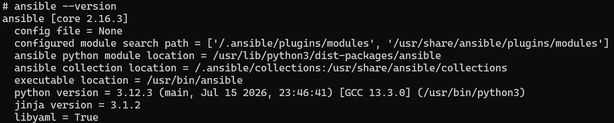

### Parte B. Preparar la flota de servidores destino

En lugar de servidores en la nube, la flota son tres contenedores `rastasheep/ubuntu-sshd:18.04` con `sshd` ya arrancado. `app1` y `app2` alojarán la API y `db1` la base de datos. Cada uno expone su SSH en un puerto distinto del anfitrión (2223, 2224 y 2225), y las máquinas `app` exponen además el puerto en el que quedará la API (8081 y 8082). Son `privileged` porque dentro de cada una correrá su propio Docker.

> **Nota:** Este `docker-compose.yml` no tiene nada que ver con el de la aplicación del Boletín 3. Aquí cada contenedor representa una máquina, no un servicio.

```bash
docker compose -f deploy/servidores/docker-compose.yml up -d
docker ps
```

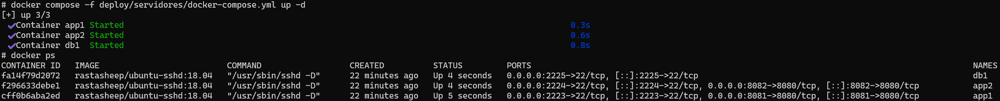

Antes de usar Ansible se comprobó a mano que se puede entrar por SSH en las tres máquinas (usuario `root`, contraseña `root`):

```bash
ssh root@localhost -p 2223   # app1
ssh root@localhost -p 2224   # app2
ssh root@localhost -p 2225   # db1
```

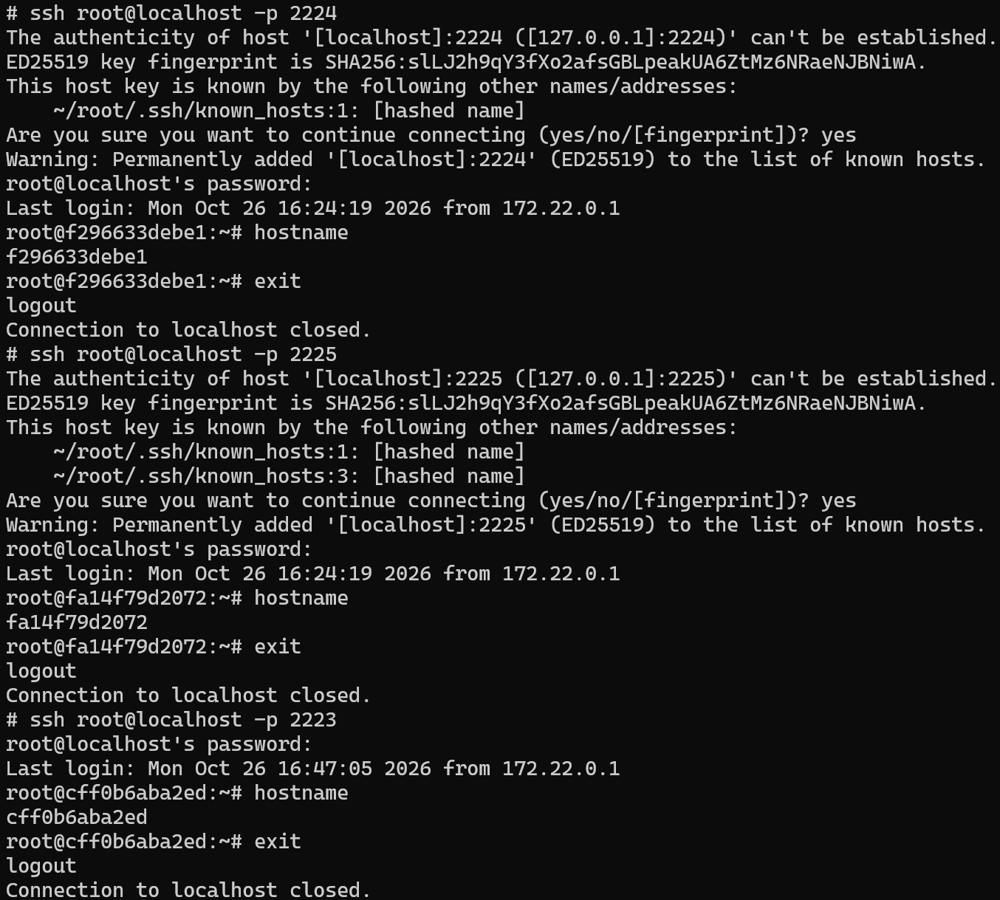

### Parte C. El inventario

`deploy/inventory.ini` agrupa las máquinas por rol: `app1` y `app2` en el grupo `app`, y `db1` en el grupo `db`. El grupo `servidores` contiene a los dos (`:children`), y en `[servidores:vars]` se define lo que comparten todas: el intérprete de Python de destino, la contraseña SSH y las opciones que evitan comprobar la clave del host, que cambia cada vez que se recrea un contenedor.

```ini
[app]
app1 ansible_host=localhost ansible_port=2223 ansible_user=root
app2 ansible_host=localhost ansible_port=2224 ansible_user=root

[db]
db1 ansible_host=localhost ansible_port=2225 ansible_user=root

[servidores:children]
app
db

[servidores:vars]
ansible_python_interpreter=/usr/bin/python3
ansible_password=root
ansible_ssh_common_args='-o StrictHostKeyChecking=no -o UserKnownHostsFile=/dev/null'
```

Como el inventario usa contraseña en lugar de clave, Ansible necesita `sshpass` (instalado en la Parte A). Con el inventario se lanza un `ping` de Ansible a todo el grupo `servidores`:

```bash
ansible -i deploy/inventory.ini servidores -m ping
```

Las tres máquinas responden `pong`, así que Ansible ya controla toda la flota:

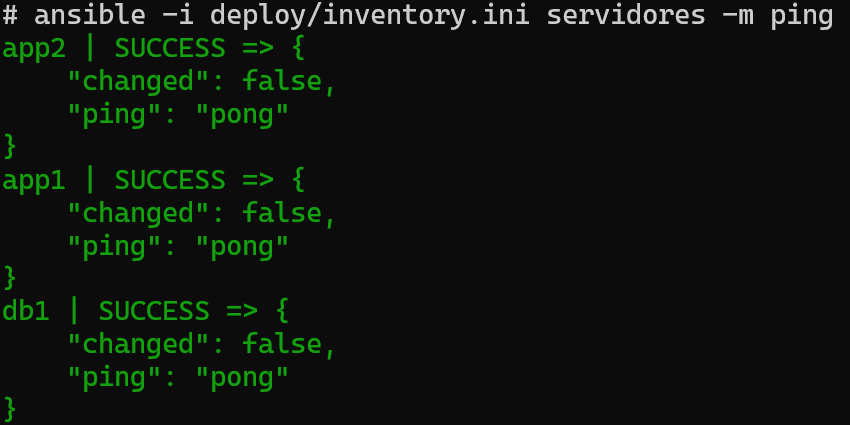

### Parte D. El playbook de despliegue

El playbook `deploy/deploy.yml` se divide en tres plays, uno por cada fase del despliegue:

1. **Preparar Docker en toda la flota** (`hosts: servidores`): instala `docker.io` y `python3-docker` con `apt` y arranca `dockerd` a mano, porque los contenedores que hacen de servidores no tienen systemd. El arranque espera hasta 30 segundos a que `docker info` responda y, si no lo hace, muestra `/var/log/dockerd.log` y falla.
2. **Desplegar la base de datos** (`hosts: db`): crea el contenedor `tareas-db` con `postgres:16`, un volumen `tareas-db-data` para que los datos sobrevivan y un healthcheck con `pg_isready`. Usa `network_mode: host` para que PostgreSQL escuche en el puerto 5432 de `db1`.
3. **Desplegar la API de tareas** (`hosts: app`): descarga la imagen publicada en el Boletín 5, `ghcr.io/sergioantonlopezumu/pc_26-27:1.0.0`, y arranca `tareas-api` en `app1` y `app2`. La URL de la base de datos se construye con `host_bd: "{{ groups['db'][0] }}"`, que resuelve a `db1`, y el smoke test espera a que `/actuator/health` devuelva `UP`.

La clave para que la API encuentre a la base de datos es que cada "ordenador" de la flota es un contenedor con su propio Docker dentro (Docker-in-Docker). Con `network_mode: host`, el contenedor de la API comparte la red de la máquina que lo aloja (`app1` o `app2`), así que puede resolver `db1` igual que lo hace la propia máquina y PostgreSQL queda expuesto directamente en su puerto. Sin ese modo, la API viviría en una red interna aislada y no vería a la base de datos.

Las credenciales (`db_name`, `db_user`, `db_pass`, `ghcr_user` y `ghcr_token`) no se escriben en el playbook: se inyectan como variables en tiempo de ejecución. El playbook se lanza con:

```bash
ansible-playbook -i deploy/inventory.ini deploy/deploy.yml --ask-vault-pass
```

El resultado de la primera ejecución fue:

```text
PLAY RECAP
app1 : ok=7 changed=4 unreachable=0 failed=0 skipped=1 rescued=0 ignored=0
app2 : ok=7 changed=4 unreachable=0 failed=0 skipped=1 rescued=0 ignored=0
db1  : ok=5 changed=3 unreachable=0 failed=0 skipped=0 rescued=0 ignored=0
```

Una segunda ejecución terminó con `changed=0` en los tres hosts, lo que confirma que el playbook es idempotente. Los contenedores quedaron sanos y la API respondió en los dos servidores:

```text
db1  -> tareas-db   Up (healthy)
app1 -> tareas-api  Up (healthy)
app2 -> tareas-api  Up (healthy)

http://localhost:8081/actuator/health -> {"status":"UP"}
http://localhost:8082/actuator/health -> {"status":"UP"}
```

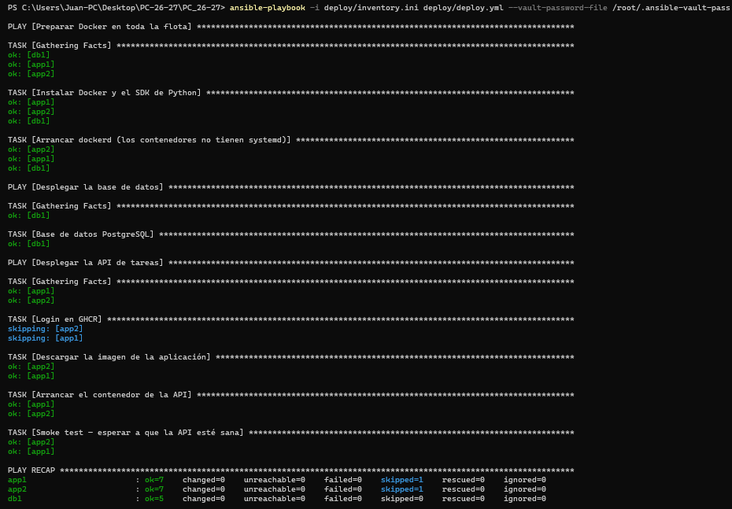

### Parte E. Proteger las credenciales con Ansible Vault

Las credenciales del despliegue no se escriben en `deploy.yml` ni se pasan por la línea de comandos. Se guardan en un fichero cifrado con Ansible Vault que sí se versiona en el repositorio:

```bash
ansible-vault create deploy/group_vars/servidores/vault.yml
```

El contenido del vault es:

```yaml
ghcr_user: sergioantonlopezumu
ghcr_token: ""          # la imagen es pública; si fuera privada, PAT con read:packages
db_name: tareas
db_user: app
db_pass: una_clave_larga
```

`db_pass` es en realidad una contraseña aleatoria de 32 caracteres hexadecimales; aquí se muestra un valor de ejemplo. `ghcr_token` está vacío porque la imagen `ghcr.io/sergioantonlopezumu/pc_26-27:1.0.0` es pública: el playbook omite el login en GHCR cuando el token está vacío y descarga la imagen directamente. Si el paquete fuera privado, bastaría con poner un PAT con permiso `read:packages`.

Al estar en `group_vars/servidores/`, Ansible carga el vault automáticamente para el grupo `servidores`, así que los tres plays ven las variables sin necesidad de `vars_files` ni de `--extra-vars`.

El fichero versionado es ilegible. Se comprueba con `cat`:

```bash
cat deploy/group_vars/servidores/vault.yml
```

```text
$ANSIBLE_VAULT;1.1;AES256
62386562343566316336333063653034643161613931613163613739643237633837666433356336
...
```

Para modificar las credenciales se usa:

```bash
ansible-vault edit deploy/group_vars/servidores/vault.yml
```

Y para lanzar el playbook hay que indicar la contraseña maestra del vault:

```bash
ansible-playbook -i deploy/inventory.ini deploy/deploy.yml --ask-vault-pass
```

También se puede usar un fichero con la contraseña, fuera del repositorio:

```bash
ansible-playbook -i deploy/inventory.ini deploy/deploy.yml --vault-password-file /root/.ansible-vault-pass
```

La contraseña maestra no se versiona: se guarda fuera del repositorio (en este caso, en `/root/.ansible-vault-pass` dentro de WSL) o en un gestor de contraseñas. Lo único que llega a GitHub es el vault cifrado.

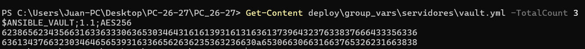

### Parte F. Ejecutar el despliegue a mano

Para verificar el correcto funcionamiento del despliegue en local antes de automatizarlo en CI/CD, se ejecutó manualmente el playbook sobre toda la flota:

```bash
ansible-playbook -i deploy/inventory.ini deploy/deploy.yml \
  --ask-vault-pass --extra-vars "version_app=1.0.0"
```

Tras la ejecución, se comprobó mediante `curl` que la aplicación respondía correctamente en ambas réplicas y que ambas accedían a la misma base de datos en `db1`:

```bash
curl http://localhost:8081/api/tasks   # app1
curl http://localhost:8082/api/tasks   # app2
```

Se validó la **idempotencia**: al volver a lanzar exactamente el mismo comando, Ansible reportó `changed=0` en los tres hosts, demostrando que no se realizaron modificaciones innecesarias dado que el sistema ya se encontraba en el estado deseado.

Asimismo, se probó la actualización a una nueva versión (`version_app=1.1.0`) y la capacidad de realizar un **rollback** instantáneo volviendo a `version_app=1.0.0` en menos de un minuto, gracias a la inmutabilidad de los tags de contenedores.

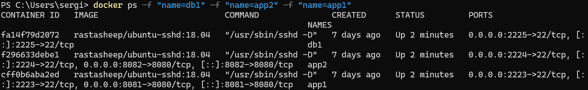
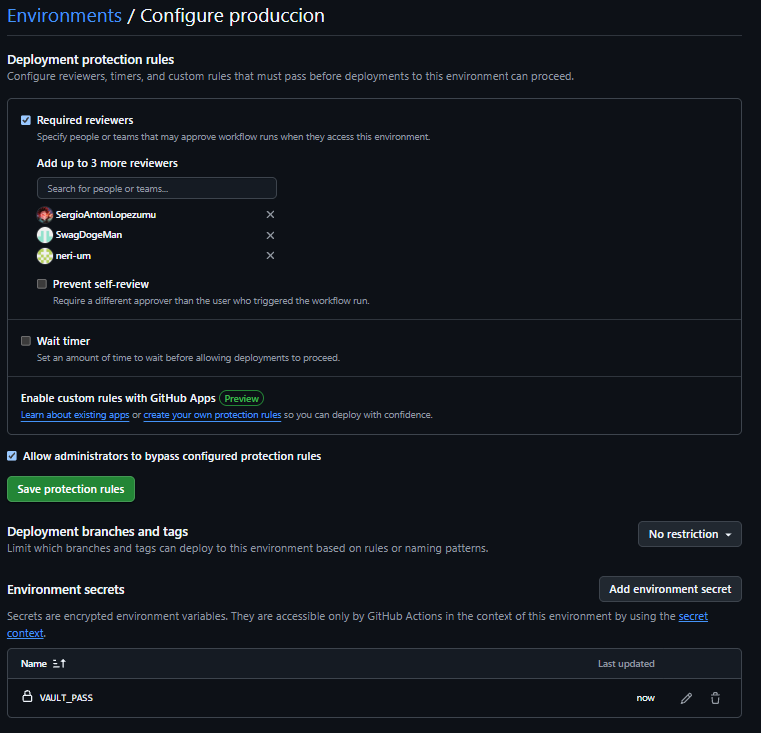

### Parte G. Disparar el despliegue desde GitHub Actions (cierre CD)

#### G.1. Registro del runner autoalojado

Se configuró un runner self-hosted (`self-hosted`) en la máquina de desarrollo (WSL2 / entorno local) conectado al repositorio de GitHub mediante `config.sh` y ejecutándose con `./run.sh`, permitiendo que GitHub Actions ejecute comandos de Ansible contra los contenedores locales (`localhost:2223`, `2224`, `2225`).

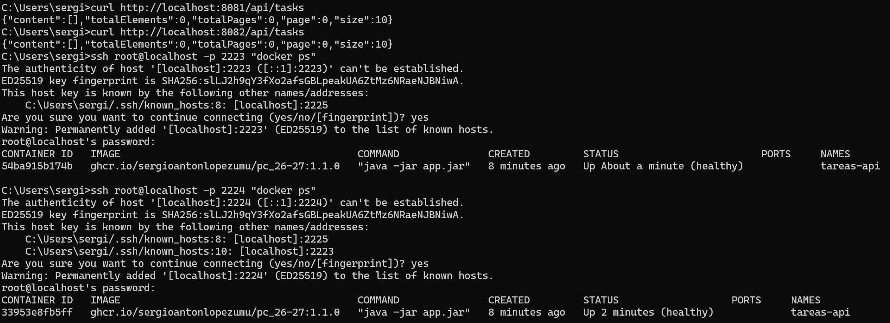

#### G.2. Entorno protegido y secretos

Se creó el environment `produccion` en GitHub con un revisor requerido obligatorio (`Required reviewer`), y se configuró el secret `VAULT_PASS` con la contraseña maestra del Ansible Vault.

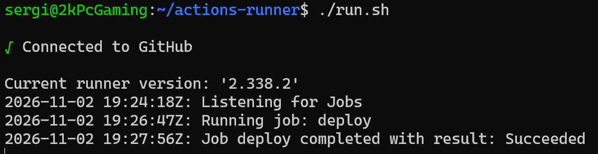

#### G.3. Ampliación del workflow `release.yml`

Se añadió el job `deploy` que depende de `publish`, se ejecuta únicamente en `self-hosted` ante etiquetas `vX.Y.Z`, requiere aprobación en el entorno `produccion`, instala la collection de Ansible y ejecuta el playbook inyectando la versión y la contraseña del vault de forma segura mediante un archivo temporal (`mktemp` / `trap`).

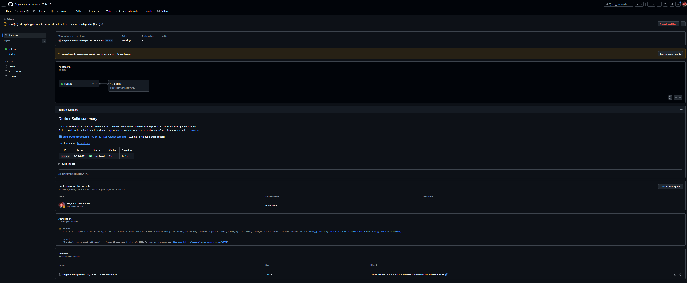

#### G.4. Arquitectura y flujo completo de CD

##### Diagrama de Arquitectura 
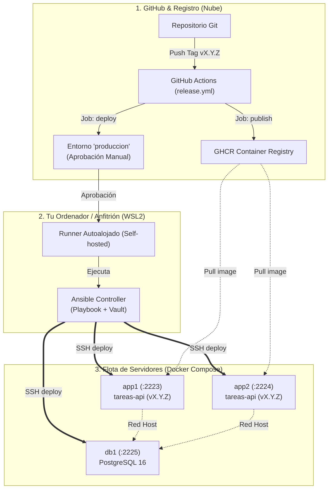

##### Pasos del flujo (desde `git push` hasta ejecución en la flota):

1. **Developer:** Ejecuta `git tag -a v1.0.0 -m "Release v1.0.0"` y `git push origin v1.0.0`.
2. **GitHub Actions (`publish`):** Se activa el workflow `release.yml`. Compila la aplicación, genera los metadatos de Docker y sube la imagen `ghcr.io/sergioantonlopezumu/pc_26-27:1.0.0` a GHCR.
3. **Pausa por Entorno Protegido:** El job `deploy` espera en el entorno `produccion` hasta que un revisor autorizado apruebe manualmente el despliegue en la interfaz de GitHub.
4. **Runner Autoalojado:** Una vez aprobado, el trabajo pasa al runner autoalojado que corre en el ordenador del usuario.
5. **Ansible Playbook Execution:** El runner ejecuta `ansible-playbook` usando la contraseña de vault leída desde el secret `VAULT_PASS`.
6. **Flota Destino:** Ansible se conecta vía SSH a `app1`, `app2` y `db1`, asegura que Docker está activo, levanta `tareas-db` en `db1` y despliega `tareas-api` en las réplicas `app1` y `app2` conectadas a la base de datos, realizando finalmente un smoke test sobre `/actuator/health`.
